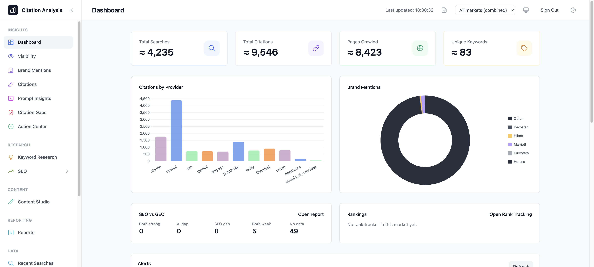
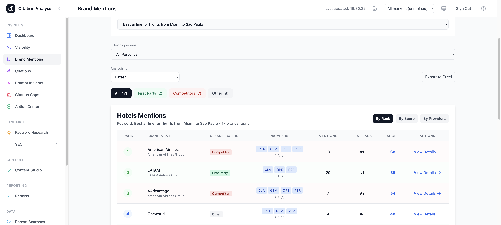
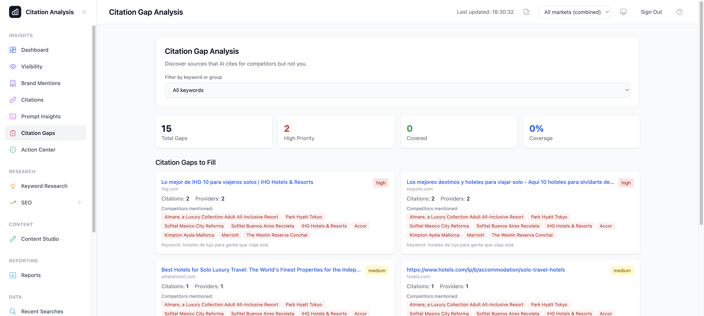
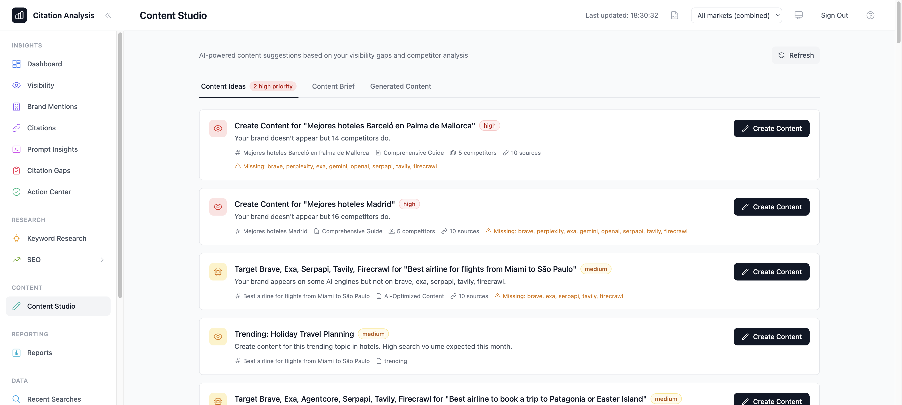
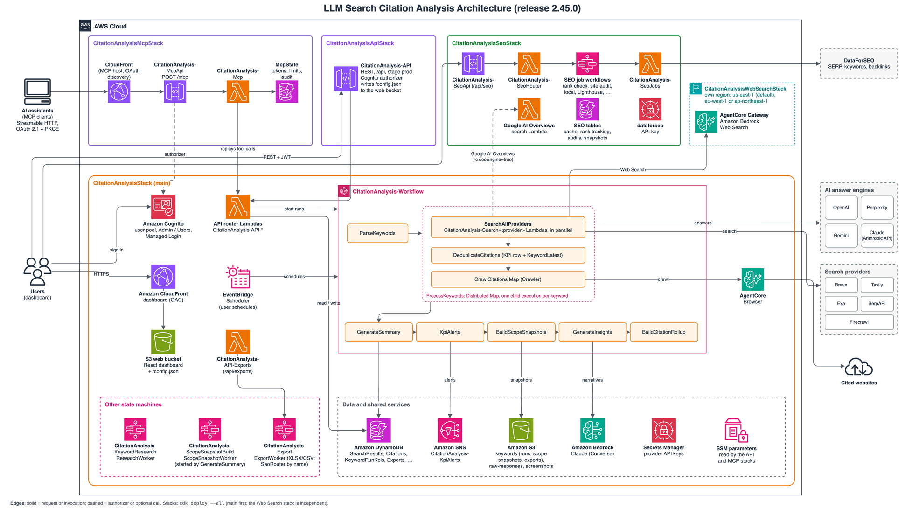

# Citation Analysis System: track your brand's visibility in AI search (GEO / AEO)

An open-source, self-hosted AI visibility tracker for generative engine optimization (GEO) and answer engine optimization (AEO), built on AWS. It shows how OpenAI (the models behind ChatGPT), Perplexity, Gemini, Claude and, optionally, Google AI Overviews mention and cite your brand, which sources they cite for your competitors but not for you, and what content to create next. It accompanies the AWS Builder Center article [Track your brand's visibility in AI search with a citation analysis tool](https://builder.aws.com/content/39o3JtrRqnsKKyKF0r5ZODrP751/track-your-brands-visibility-in-ai-search-with-a-citation-analysis-tool).

> **Important:** This is sample code for demonstration and educational purposes. It is not intended for production use without additional security review and testing. You should work with your security and compliance teams to meet your organizational requirements before deploying to production environments.

A serverless system that tracks how AI engines (OpenAI, Perplexity, Gemini, Claude and, optionally, Google AI Overviews) mention and cite brands. It sends your keywords to each engine with web search enabled, stores every answer and its citations, extracts the brands named, crawls the cited pages with Amazon Bedrock AgentCore, and reports visibility KPIs, competitor benchmarks and content gaps in a React dashboard. An optional SEO stack puts Google organic data from DataForSEO (rankings, domains, backlinks, local results, site audits) next to the AI-visibility figures. It is deployed with AWS CDK (TypeScript) as five CloudFormation stacks; the backend is Python 3.12 Lambda functions orchestrated by AWS Step Functions.

Further documentation: [KPI definitions](docs/kpi-definitions.md), [SEO](docs/seo.md) (with one page per SEO feature), [GEO KPI corrections](docs/geo-corrections.md), [MCP server](docs/mcp.md), [design system](docs/design-system.md) and the [changelog](CHANGELOG.md), which has the upgrade notes of every release.

## Features

The dashboard sidebar has these sections:

| Section | Pages |
|---|---|
| Insights | **Dashboard** (totals, citations by provider, brand mentions, KPI alerts), **Visibility** (the KPIs for one keyword, a keyword group or all keywords, with 7/30/90-day KPI history, brand leaderboard, per-engine KPIs, cited domains and the scope's three most pressing insights; persona filter), **Brand Mentions** (every brand named, with sentiment, rank and a per-brand ranking analysis), **Citations** (cited URLs by frequency, with a per-keyword and per-provider breakdown; YouTube videos are counted once per video whatever link was cited, tagged *Video* and filterable, and their title, channel and thumbnail come from YouTube oEmbed instead of a browser crawl), **Prompt Insights** (which queries and personas rank you in the top 3), **Citation Gaps** (sources that cite competitors but not you), **Action Center** (prioritised recommendations with a status you can track); the last three take the same keyword, group or all-keywords scope as Visibility |
| Research | **Keyword Research**: Related Keywords, Keyword Explorer (search volume, difficulty, CPC and intent from DataForSEO; SEO stack), Competitor Analysis (analyse a competitor website), Research Agent (a Bedrock research agent that plans web-search queries over up to three rounds, with saved prompt templates) and History. **SEO** (SEO stack): Domain Overview, Backlinks, Rank Tracking, Site Audit, Performance and Local SEO; see [docs/seo.md](docs/seo.md) |
| Content | **Content Studio**: content ideas and briefs from citation gaps and ranking analyses, single or per keyword group, in any output language, exportable as DOCX |
| Reporting | **Reports**: ten print-ready reports (below), plus custom reports you build from their sections |
| Data | **Recent Searches** (analysis history with full answers), **Raw Responses** (raw JSON answers and crawl screenshots from S3), **Exports** (your Excel and CSV exports of the last 7 days) |
| Operations | **Run Analysis**, **Schedule** (EventBridge Scheduler runs) |
| Configuration | **Settings**: Keywords (with keyword groups), Markets, Brand Tracking, Personas, AI Providers (with the DataForSEO login under SEO data), Bedrock Models, Alerts, Users (admins only), AI Assistants (MCP connection guide) |

Every data view has **Export all** (Excel or CSV), which exports the view's full data with its current filters. The export runs on the server, however large it is, and the file appears on the **Exports** page; a header badge, a toast and, if you allow it, a browser notification say when it is ready. Content Studio's DOCX is the only file built in the browser. The header's PDF button prints the current view (print mode, `?print=1`), and the UI has light, dark and system themes. A first-run guide walks through setup, and a banner flags a provider that is failing.









### Reports

Listed on **Reporting > Reports** (`web/src/components/Reports/ReportsLandingView.tsx`), routed by `ReportsRouter.tsx`:

| Report | Route | For |
|---|---|---|
| Executive Summary | `/reports/executive-summary` | CMO, VP Marketing |
| Brand Visibility Report | `/reports/visibility` (`/reports/visibility/:keyword`) | Marketing lead |
| Competitor Benchmark | `/reports/benchmark` | Brand manager, competitive intelligence |
| AI Engines | `/reports/engines` | AI search specialist |
| Sources | `/reports/sources` | SEO and digital PR |
| Sentiment | `/reports/sentiment` | Brand / communications lead |
| SEO vs GEO | `/reports/seo-geo` | SEO and AI search lead (needs the SEO stack; see [docs/seo-metrics.md](docs/seo-metrics.md)) |
| Competitor Gap Report | `/reports/competitor` (`/reports/competitor/:competitor`) | Content / PR strategist |
| Content Action Plan | `/reports/content-action-plan` | Content strategist |
| Keyword Deep Dive | `/reports/keyword` (`/reports/keyword/:keyword`) | SEO / AI search lead |

**Custom reports** (`/reports/custom/new`, `/reports/custom/:id`, `/reports/custom/:id/edit`; `web/src/components/Reports/customReport/`): any signed-in user can name a report, pick blocks from a list sorted into categories (one per report above, an *Insights* category, plus their own headings, Markdown text, https images and YouTube or Vimeo videos), drag or add them into one ordered list and save it. Every user sees every saved report (at most 50). A saved report opens on every keyword and its saved period (30, 90 or 180 days); the reader can narrow it to a keyword group or one keyword and change the period in the URL, like the scope reports. Each data source is fetched once however many blocks read it. A block that needs a particular scope (a single keyword for the Keyword Deep Dive blocks, a keyword group for the group KPI and Run stability blocks) says so instead of showing the wrong data. The catalogue and the stored block types live in `customReport/blockCatalog.ts`.

**Insights** (`GET /api/reports/insights`, rules in `lambda/shared/insights_engine.py` and `insights_citations.py`) are derived from the KPI engine's figures for a scope by fixed rules with named thresholds: the *play* each AI engine calls for (get cited, get ranked first, both, or defend), the brand's best position per keyword and engine (a keyword every engine places outside the top 3 is a *prompt gap*), who the engines cite (your domains, each competitor's domains from Brand Tracking, third parties) and which of your pages (documents told apart from web pages), competitors the answers word mixed or negative (at least 30% of 5 or more mentions, with the reasons given), the first-party brands measured against the best of them and, for a keyword group, how far each keyword's position swung across the runs of the window. Each insight carries a severity and the numbers it rests on. The Visibility tab reads out the top three; the custom-report *Insights* blocks show the facts behind them. After every run, for each keyword group the run fully covers, a **GenerateInsights** step asks Bedrock (the `ANALYSIS` role) for up to three written insights and six recommendations from those computed insights and KPIs only, in the language of the group's keywords; a validator drops any item that cites an unknown insight or a number not in its evidence, and the result is stored in `CitationAnalysis-ReportInsights`, so reading a report never calls Bedrock. The *Written insights* block shows it; admins can regenerate it (`POST /api/reports/insights/regenerate`).

### KPIs

The Visibility tab, the per-group report, the Executive Summary, Brand Visibility, Competitor Benchmark, AI Engines, Sources, Sentiment and Keyword Deep Dive reports, their exports and the KPI alerts use one set of KPIs, counted per AI-engine answer and pooled across a scope: answers, mentions, mention rate, share of voice, average position, top-1 and top-3 share, visibility score (position-weighted, 0–100), citations, citation rate, citation share, net sentiment, engine coverage and keyword coverage. Definitions, formulas and edge cases are in [docs/kpi-definitions.md](docs/kpi-definitions.md). The Dashboard, Brand Mentions, Personas, Prompt Insights, Citation Gaps, Action Center and the Competitor Gap and Content Action Plan reports still compute their own figures.

## Architecture



The editable source is [docs/architecture.drawio](docs/architecture.drawio).

### Workflows (Step Functions)

- **`CitationAnalysis-Workflow`** (one execution per analysis run, 7-day timeout): ParseKeywords (writes the run's keyword list to `runs/<execution>/keywords.json` in the keywords bucket) → ProcessKeywords Distributed Map (one child execution per keyword: SearchAllProviders, a Parallel state calling every provider at once through its own `CitationAnalysis-Search-<provider>` Lambda → MergeProviderResults → DeduplicateCitations → CrawlCitations Map → SummarizeKeywordResult; results written to S3) → GenerateSummary (reads the results from S3, stores the full report under `execution-summaries/`) → KpiAlerts → BuildScopeSnapshots (the scope snapshots under `scope-snapshots/` in the keywords bucket, which the scoped views serve for scopes too large to read live; see below) → GenerateInsights (a Map with one ReportInsights invocation per fully covered keyword group and market, four at a time, skipped when no group is complete) → BuildCitationRollup (per-scope citation totals and pages under `citation-rollups/` in the keywords bucket, which `GET /api/citations` serves without scanning the Citations table). A failed alert, snapshot, insight or rollup step keeps the report. The run's state and history stay the same size however many keywords it covers, and there is no per-run keyword cap. Keywords run 20 at a time by default (`-c processKeywordsConcurrency=N`) and citations are crawled 10 at a time per keyword (`-c crawlConcurrency=N`). Each provider has a cap on calls in flight across the whole run (`-c providerConcurrency`); a keyword whose provider is at its cap waits for a free slot, and every client waits out rate limits (`Retry-After`, `x-ratelimit-reset`) instead of failing, so no provider call is lost to throttling. SerpAPI searches are submitted asynchronously and read back from its Search Archive, so a slow search is waited for rather than re-sent. A failed crawl or alert evaluation does not fail the run; up to 10% of keywords may fail (reported as `completed_with_errors`) before the run stops. `runs/` objects expire after 30 days.
- **`CitationAnalysis-KeywordResearch`** (one execution per research job, 60-minute timeout; the API marks a job failed only after 65 minutes): PlanResearch → ExecuteResearchSteps Map (up to 10 steps in parallel) → EvaluateResearch → continue? → PlanResearch … | FinalizeResearch. Each step checkpoints its result into the job row, so a failed provider keeps the other results and can be retried on its own.
- **`CitationAnalysis-ScopeSnapshotBuild`** (6-hour timeout; every step runs on `CitationAnalysis-ScopeSnapshotWorker`): the distributed scope snapshot and citation rollup build that GenerateSummary starts when the build needs more than one 450 MB unit or Citations holds more than 100,000 rows. PlanSnapshotBuild → in parallel FoldUnits → SeriesBatches (each batch loops 480 s turns until done) and RollupShards → RollupMerges → PublishSnapshotBuild; the Distributed Maps run 10 items at a time and every step is idempotent. One build runs at a time; smaller tenants build in process.
- **`CitationAnalysis-Export`** (one execution per export, 7-day timeout): PrepareExport → ExportChunk until every row is written → FinalizeExport; any failure → MarkExportFailed. Each chunk is one `CitationAnalysis-ExportWorker` invocation that writes rows until 60 s before its 900 s timeout, uploads S3 multipart parts and saves a cursor, so an export of any size finishes. A chunk that meets a view job still computing ends there, and the execution waits in WaitForViewJob on a task token that the worker registers against the job (several exports can wait on one job). Nothing runs while it waits. When the job finishes or fails, it publishes `view-job.finished` to the default EventBridge bus, and the `CitationAnalysis-ViewJobFinished` rule invokes the worker, which sends every waiting token back: the export runs its next chunk, or fails if the job failed. A job that finished before the token was registered resumes the export at once. If the event is lost, the wait times out after 960 s, ExportChunkAfterViewJobWait runs the chunk once more, and the export fails if the same job still computes. While it waits the export stays `running` with its progress, readable through `GET /api/exports` and `GET /api/exports/{id}`.
- **SEO state machines** (SEO stack, every step on `CitationAnalysis-SeoJobs`): `CitationAnalysis-SeoRankCheck` (rank checks: on demand, or for due trackers when the `CitationAnalysis-SeoRankTrackingTick` rule invokes the jobs function), `CitationAnalysis-SiteAudit`, `CitationAnalysis-SeoDomainSnapshots` and `CitationAnalysis-SeoBacklinkSnapshots` (weekly rules `CitationAnalysis-SeoDomainSnapshotsWeekly` and `CitationAnalysis-SeoBacklinkSnapshotsWeekly`), `CitationAnalysis-SeoLocalJob` (local rank grid, reviews, profile updates) and `CitationAnalysis-SeoLighthouse`.

SearchAllProviders also calls `CitationAnalysis-Search-google_ai_overview` (in the SEO stack) once per keyword, whatever the personas. Google AI Overviews stays off until an Admin switches it on in Settings (saving the DataForSEO login does not), so until then the call answers no rows and spends nothing. If the SEO stack is missing, each keyword gets a failed Google row naming the missing function.

**Complete scoped views.** A scoped view (a keyword group, a market or all keywords) is read live when the estimated rows, keywords × (max(1, enabled personas) × engines + one Google AI Overviews answer) × runs needed, are at most 8,000 (`shared/scope_source.py`; at 10 personas that is 97 keywords); one keyword or a selection of up to 100 keywords is always live. A larger scope is served from the scope snapshot: `all`, every market and every larger group or group × market, rebuilt after each run and after keyword, group, market, brand-configuration or persona changes. The snapshot is built from one `KeywordLatest` object per keyword (`scope-snapshots/keywords/`), which DeduplicateCitations writes with the KPI row, and a per-scope series of up to 365 runs. A view the snapshot does not hold (another number of days, an older run, no build yet) answers `202 {status: "computing"}` while a view job computes it, and the same request answers 200 once it is stored. Every scoped answer carries `coverage` (`keywords_total`, `keywords_analyzed`, `complete`), `source`, `as_of` and `stale`, which the dashboard shows as "Covers X of Y keywords"; list cursors are tied to their build and answer `400 cursor_expired` when it is gone.

### Lambda functions

All functions run Python 3.12. Lambda allocates CPU in proportion to memory. The 2.45.0 sizes are the owner's decision of 2026-11-07, informed by AWS Lambda Power Tuning of the read-only routes, a 30-day CloudWatch REPORT audit (no function at 60% of its memory) and per-invocation probes at 10x volume (5,000 keywords, 365 runs, 10 personas; tracemalloc):

- **1,769 MB (one vCPU):** API-StatsInsights, API-CitationsContent, API-GetBrandMentions and ReportInsights (they deserialize thousands of rows per request, and the live window row cap scales with memory); KpiAlerts (300 s); ExportWorker (900 s); GenerateSummary (900 s), which builds the run summary and, in process, a citation rollup of up to 100,000 Citations rows and a snapshot build within one 450 MB unit; ScopeSnapshotWorker (900 s), whose fold units, series turns, rollup shards and merges peaked at about 606 MB of heap and under 600 CPU s at 10x.
- **1,024 MB:** API-KeywordMgmt, API-ConfigMgmt, API-ExecutionMgmt, API-ManageBrandConfig, API-GetPersonaRankings, ParseKeywords, Crawler, and Deduplication (300 s), which also records each keyword run's KPI counts and `KeywordLatest` object.
- **512 MB:** API-Health, API-ManageUsers, API-SelfReflection, API-ContentStudio, API-Exports, Mcp, the Search functions, ResearchWorker and ContentStudioWorker.
- **256 MB:** KpiWriteFailureRelay.

API functions stop at API Gateway's 29 s; inside it, every request carries a time budget (`lambda/shared/request_deadline.py`) and answers partial data with a truncation flag instead of a 504.

| Function | Code | Role |
|---|---|---|
| ParseKeywords, Search, Deduplication, Crawler, GenerateSummary, KpiAlerts | `lambda/parse-keywords`, `search`, `deduplication`, `crawler`, `generate-summary`, `kpi-alerts` | Analysis workflow steps |
| ResearchWorker | `lambda/research-worker` | Keyword research steps |
| API-StatsInsights, API-CitationsContent, API-KeywordMgmt, API-ConfigMgmt, API-ExecutionMgmt, API-GetBrandMentions, API-ManageBrandConfig, API-GetPersonaRankings, API-SelfReflection, API-ContentStudio, API-ManageUsers, API-Health | `lambda/api/*.py` | REST API handlers; the consolidated functions bundle several handler files each |
| ContentStudioWorker | `lambda/api/content-studio.py` | Content generation, fed by a DynamoDB stream and a 5-minute reconcile rule |
| ReportInsights | `lambda/report-insights/` | GenerateInsights workflow step and on-demand regenerate: one Bedrock narrative per fully covered keyword group |
| ScopeSnapshotWorker | `lambda/generate-summary/` | Every step of the distributed scope snapshot build (`CitationAnalysis-ScopeSnapshotBuild`) |
| ExportWorker, API-Exports | `lambda/export-worker/`, `lambda/api/exports.py` | The export service: the `CitationAnalysis-Export` steps, and the `/api/exports` routes |
| KpiWriteFailureRelay | inline (`lib/constructs/kpi-write-failure-alarm.ts`) | Publishes the KPI write-failure alarm to the KPI alerts topic |
| Mcp (stack `CitationAnalysisMcpStack`) | `lambda/mcp/` | MCP server: JSON-RPC over Streamable HTTP, tool catalogue, replays tool calls against the API handler Lambdas |
| SeoRouter, SeoJobs, Search-google_ai_overview (stack `CitationAnalysisSeoStack`) | `lambda/seo/`, `lambda/seo-jobs/`, `lambda/search/` | The SEO API's one router (512 MB), every step of the SEO state machines (1,024 MB, 15 minutes), and the Google AI Overviews engine |

Two layers: the **shared layer** (`lambda/layer/`: `lambda/shared` modules plus `requests`, `bs4` and `tzdata`) used by every function except the crawler (the SEO stack builds its own version, `CitationAnalysis-SeoSharedLayer`, and the MCP stack `CitationAnalysis-McpSharedLayer`, from the same directory), and the **crawler layer** (`lambda/crawler-layer/`: Playwright, Bedrock AgentCore and a copy of the shared modules). Synth fails if either layer is not built or its copy of `lambda/shared` is stale. The crawler uses a pre-created AgentCore browser with Web Bot Auth and reuses a crawl for 30 days.

### Data

All tables are DynamoDB on-demand with AWS-managed encryption, point-in-time recovery and `RETAIN`:

| Table (`CitationAnalysis-…`) | Key | Holds |
|---|---|---|
| SearchResults | keyword / timestamp_provider | Every provider answer, with extracted brands and its `market_id` |
| Citations | keyword / normalized_url | Every deduplicated citation, with `content_type` (`video` or `page`) |
| KeywordRunKpis | keyword / run_timestamp | One row of KPI counts per keyword and run (at most 25 brands), which the history views add up instead of re-reading every answer; see [KPI backfill](#kpi-backfill) |
| KeywordRunBrands | keyword / run_timestamp | The full brand list of a keyword run, written only when it names more than 25 brands; read by the scope series and window view jobs |
| Exports | export_id | Export jobs (GSI `OwnerCreatedIndex` owner / created_at; TTL 7 days) |
| CrawledContent | normalized_url / crawled_at | Crawled page content, summaries and SEO data |
| Keywords | id | Keywords; `group_ids` holds group membership, `market_id` the market, `concept_id` the keyword a translation localizes |
| KeywordGroups | id | Keyword groups |
| KeywordResearch | id | Research jobs and their steps (TTL) |
| ResearchTemplates | id | Saved research agent prompts |
| BrandConfig | config_id | Industry, first-party and competitor brands, owned domains (`default`); the market list (`markets`) |
| ProviderConfig | provider_id | Provider enablement, model override, health |
| QueryPrompts | id | Personas |
| ContentStudio, ContentBriefBatches, ContentBriefTemplates | id / batch_id / id | Generated content, batch manifests, saved prompt templates |
| CustomReports | id | Saved custom reports (title, ordered blocks, period; at most 50) |
| SelfReflection | keyword_brand / persona_timestamp | Ranking analysis cache (24 h TTL) |
| RecommendationStatus | recommendation_id | Action Center item status (TTL) |
| ReportInsights | scope_key / run_timestamp | Written insights per keyword group and market (TTL), read by the reports |
| KpiSnapshots, KpiAlerts, AlertSettings, ContentChanges | group_id / snapshot_at, id, config_id, group_id / changed_at | KPI alert baselines, alerts, thresholds, content-change markers |

These 24 tables are in `CitationAnalysisStack`. `CitationAnalysisMcpStack` adds `CitationAnalysis-McpState` (spend tokens, per-caller counters, audit), and `CitationAnalysisSeoStack` adds the six below.

The SEO stack (`CitationAnalysisSeoStack`) adds its own tables, with the same settings. Measurements are kept and
never expire (Silver); only caches, receipts, locks and crawl bookkeeping carry a TTL:

| Table (`CitationAnalysis-…`) | Key | Holds |
|---|---|---|
| SeoKeywordMetrics | keyword_id / market_id | The latest search volume, CPC, difficulty and intent per keyword and market: a cache of DataForSEO's values, replaced whole on each refresh, not a history |
| SeoCache | cache_key | Paid-answer cache (TTL per answer; payloads over 350 KB in the `seo` bucket), local SEO jobs, Lighthouse runs and IndexNow history (kept), DataForSEO callback gates (`callback#<id>`, 2-day TTL) |
| SeoRankTracking | pk / sk, GSI1 | Trackers (`TRACKER#<id>` / `META`), their extra keywords (`KW#`), runs (`RUN#`), per-keyword state (`STATE#`) and each check's results (`RUN#<run>` / `PAIR#<keyword>#<device>`, history through GSI1) (Silver, kept); the run lock (`ACTIVE_RUN`, TTL) |
| SeoDomainSnapshots | `<domain>#<market_id>` / snapshot_at | Each traffic snapshot's overview figures (Silver, kept); its ranked keywords are in the `seo` bucket |
| SeoBacklinkSnapshots | domain / snapshot_at | Each backlink snapshot's overview metrics (Silver, kept) |
| SeoAudits | pk / sk, GSI1 | Site audits, their pages, issues and link summary (kept); the crawl's frontier URLs (90-day TTL) |

The `seo` bucket (`citation-analysis-seo-<account>`) holds `seo/cache/<key>.json` (oversized cache payloads),
`seo/lighthouse/<run>-<index>.json` (full Lighthouse reports), `seo/domain-snapshots/<domain>/<market>/<snapshot_at>.json`
(a snapshot's ranked keywords, written once) and `seo/site-audit/<id>/robots.txt`.

S3 buckets (`citation-analysis-<name>-<account>`): `keywords` (keyword files, run summaries, the citation rollup, the scope snapshots under `scope-snapshots/` and the export files under `exports/<owner>/<id>/`; view job results and export files expire after 7 days), `raw-responses` (the providers' answers only), `screenshots` (moved to Infrequent Access after 90 days), `web` (the dashboard) and `access-logs` (expire after 90 days). The SEO stack adds `seo` (oversized cache payloads, Lighthouse reports, domain-snapshot keywords and robots.txt copies). KPI alert emails go through the SNS topic `CitationAnalysis-KpiAlerts`.

### API and hosting

A REST API (`CitationAnalysis-API`, stage `prod`, all routes under `/api`) with Lambda proxy integrations and a Cognito user pool authorizer on every route except `GET /api/health`. It has its own stack, `CitationAnalysisApiStack` (`lib/api-stack.ts`, routes in `lib/constructs/rest-api.ts`), which takes nothing from `CitationAnalysisStack` by cross-stack reference (it builds the API Lambdas' ARNs from their fixed names and the web bucket name from the account, and reads the user pool id, the distribution id and the dashboard origin from SSM parameters the main stack writes: `/citation-analysis/user-pool-id`, `/citation-analysis/web-distribution-id`, `/citation-analysis/cors-origin`, plus the live events domains `CitationAnalysisEventsStack` writes to `/citation-analysis/live-events-http-domain` and `/citation-analysis/live-events-realtime-domain`) and is deployed after both; it also writes `config.json` (`{"apiUrl": "<stage URL>/api", "liveEvents": {"httpDomain", "realtimeDomain"}}`) into the web bucket, which the dashboard reads at startup, so neither the API URL nor the live events endpoints are built into the bundle. Saved custom reports are `GET`/`POST /api/custom-reports` and `PUT`/`DELETE /api/custom-reports/{id}` on API-ConfigMgmt, open to any signed-in user. Exports are `POST /api/exports {view, params, format}`, `GET /api/exports`, `GET`/`DELETE /api/exports/{id}` and `POST /api/exports/{id}/seen` on API-Exports: any signed-in user can export, sees only their own exports (Admin included), and has at most 5 queued or running; a download is a 15-minute presigned URL minted on each request, and the file key is never returned. The SEO exports need the SEO stack: the export worker invokes `CitationAnalysis-SeoRouter` by name. The dashboard is a static Vite build in a private S3 bucket served by CloudFront through origin access control; its content security policy allows embedded players from `www.youtube-nocookie.com` and `player.vimeo.com` only (custom report video blocks).

The SEO features have their own REST API in `CitationAnalysisSeoStack` (`lib/seo-stack.ts`): `CitationAnalysis-SeoApi`, routes under `/api/seo/`, one router Lambda (`CitationAnalysis-SeoRouter`), a Cognito authorizer on the same user pool and a stage throttle of 20 requests per second (burst 40). The stack imports only the user pool and the `CitationAnalysis-CorsOrigin` export from the main stack. Its URL is the stack output `SeoApiUrl`, which `scripts/build-web.sh` builds into the dashboard as `VITE_SEO_API_URL`; without the stack, the SEO pages say the SEO stack is not deployed. Setup, pages, permissions and DataForSEO prices: [docs/seo.md](docs/seo.md).

### Live updates (AppSync Events)

The dashboard is told when a job changes instead of polling for it ([TENETS.md](TENETS.md), tenet 8). The pieces:

- **Events.** The workers put thin change events on the default EventBridge bus (`lambda/shared/change_events.py`): ids and a status, never the state itself. Each function may only put its own area's source (`events:source` condition). Step Functions adds the status changes of the analysis workflow, keyword research and the scope snapshot build, and every keyword of a run ends with a `run.keyword.finished` event (`PublishKeywordProgress`).
- **Relay.** `CitationAnalysisEventsStack` (`lib/events-stack.ts`) has two EventBridge rules (sources `citation-analysis.*`, and those state machines' status changes) that invoke `CitationAnalysis-LiveEventsRelay` (`lambda/live-events/`). The relay picks the channel from a fixed table (`live_channel_routes.py`), copies only the ids and status the route names, and publishes over the Event API's HTTP endpoint signed with IAM. Its role may only `appsync:EventPublish` to the two namespaces.
- **Channels.** The Event API `CitationAnalysis-LiveEvents` accepts connections and subscriptions with the Cognito ID token, and publishes from IAM only. `/deployment/<topic>` (runs, research, content-studio, insights, view-jobs, snapshots, alerts, seo) carries changes to state every signed-in user may already read through the API. `/user/<sub>/exports` carries a user's own exports: the namespace's subscribe handler refuses any channel whose second segment is not the caller's Cognito `sub`, so nobody hears another user's exports.
- **Dashboard.** One WebSocket per tab (`web/src/infrastructure/liveEvents/`), opened only while a view watches a running job and closed 10 s after the last one stops. A view subscribes while its job runs, reads its REST route once when the subscription becomes active (and after every reconnect, to catch up), and again after each event about that job. Reconnects back off from 1 s to 30 s, at most 8 times in a row; then the next `online` or `visibilitychange` event of the page tries again.

Every state an event announces stays readable through its REST route and MCP; clients that cannot subscribe (a CLI, an MCP tool call) read it when they need it. Without the events stack (or on `npm run dev` without `VITE_LIVE_EVENTS_*`) a view reads its job once and is not told when it changes.

### MCP server (preview)

A second stack, `CitationAnalysisMcpStack`, holds an MCP server for AI assistants (Kiro, Claude.ai and Claude Code, ChatGPT, Amazon Quick): a Streamable HTTP endpoint, `POST /mcp` on its own REST API (`CitationAnalysis-McpApi`) behind its own CloudFront distribution, which gives the server a host root so clients find the OAuth discovery documents where RFC 9728 and RFC 8414 put them (`https://<dist>.cloudfront.net/mcp`, `https://<dist>.cloudfront.net/.well-known/...`), and one Lambda (`CitationAnalysis-Mcp`, reserved concurrency 10) that replays every tool call against the existing API handler Lambdas as the signed-in user, so permissions and figures are the dashboard's. `tools/list` advertises eight direct tools (keyword groups, keywords, brand configuration, visibility, reports, citations, recommendations, keyword management) plus `search_tools` → `describe_tool` → `call_tool` over a catalogue of 44 more (`lambda/mcp/catalogue.py`; among them the SEO reads and the DataForSEO spend tools, which need the SEO stack), and two prompts (`geo_audit`, `setup_brand_tracking`); `-c mcpPinnedTools` promotes catalogue entries to the direct list. Operations that spend money take two steps: `estimate_run` / `estimate_research` / `estimate_content_brief` return a call count and a single-use confirmation token (5 minutes, bound to the caller and the exact request), which `start_run` (admin only, as on the dashboard) / `start_research` / `generate_content_brief` must present (the DataForSEO operations work the same way: `estimate_seo_*` then `run_seo_*` or, for admins, `start_seo_job`). Per-caller limits default to 1 run in flight, 5 runs and 20 research or content jobs per UTC day, and 50 keywords per run (`-c mcpLimits='{"runsPerDay":10}'`); DataForSEO lookups draw on the one daily limit of paid DataForSEO calls per user that an Admin sets in Settings › AI Providers › SEO data (default 100), shared with the dashboard and the REST API; tokens, counters and an audit record of every write and spend call live in the on-demand `CitationAnalysis-McpState` table. User management, provider keys, brand-configuration and schedule writes and deletes are not exposed. Clients sign in with OAuth 2.1 and PKCE through a Cognito Managed Login domain (`citation-analysis-<account>`) and a public `mcp` app client (1-hour access tokens, 90-day refresh tokens). The protected-resource metadata (at `/.well-known/oauth-protected-resource/mcp`) names the distribution's base URL as the authorization server, and the API serves its metadata at `/.well-known/openid-configuration` and `/.well-known/oauth-authorization-server`, pointing at Cognito's endpoints and advertising PKCE S256 (Cognito's own discovery document omits `code_challenge_methods_supported`, which makes Claude and ChatGPT refuse to connect). The Cognito resource server is identified by the MCP endpoint URL, so the scopes are `<McpUrl>/read`, `<McpUrl>/write` and `<McpUrl>/run` and a client that sends the endpoint as the RFC 8707 `resource` parameter gets an access token whose `aud` is the endpoint. Behind the Cognito authorizer the Lambda checks the token's issuer, client, use and audience; an anonymous call gets `401` with a `WWW-Authenticate` pointer to the protected-resource metadata (RFC 9728). Register each client's callback URL with `-c mcpRedirectUris`; the stack outputs `McpUrl`, `McpClientId`, `McpAuthorizeUrl`, `McpTokenUrl` and `McpResourceMetadataUrl` are what a client's connection form asks for. Per-client steps are in [docs/mcp.md](docs/mcp.md) and, for signed-in users, on the dashboard's Settings › AI assistants section (`/settings/ai-assistants`), which takes the URL and client id from the stack outputs at build time. The stack lives in `lib/mcp-stack.ts` and can be destroyed on its own. Dynamic client registration is not offered; clients use the pre-registered `McpClientId`.

Kiro CLI connects with a server entry like this (in `.kiro/settings/mcp.json` or an agent's `mcpServers`), after `http://localhost:5173/oauth/callback` (the default `mcpRedirectUris` value) is registered; Kiro opens the Managed Login page in the browser and stores the token:

```json
{
  "mcpServers": {
    "citation-analysis": {
      "url": "<McpUrl>",
      "oauth": {
        "clientId": "<McpClientId>",
        "redirectUri": "http://localhost:5173/oauth/callback"
      }
    }
  }
}
```

## Project structure

```
├── bin/                     # CDK app entry point (six stacks: CitationAnalysisStack, CitationAnalysisApiStack, CitationAnalysisEventsStack, CitationAnalysisMcpStack, CitationAnalysisSeoStack, CitationAnalysisWebSearchStack)
├── lib/
│   ├── citation-analysis-stack.ts  # Tables, buckets, workflows, Lambdas, Cognito, CloudFront
│   ├── api-stack.ts         # Dashboard REST API stack (+ config.json)
│   ├── events-stack.ts      # Live events: AppSync Events API and the relay from EventBridge
│   ├── mcp-stack.ts         # MCP server stack
│   ├── seo-stack.ts         # SEO API, SEO jobs and the Google AI Overviews engine (features in seo-features.ts)
│   ├── web-search-stack.ts  # Amazon Bedrock Web Search gateway
│   └── constructs/          # auth.ts (Cognito), rest-api.ts (dashboard routes), tables.ts, provider-search.ts, kpi-write-failure-alarm.ts, bedrock-model-access.ts, mcp-server.ts, seo-api.ts and one seo-<feature>.ts per SEO page
├── lambda/
│   ├── api/                 # API handlers (exports.py: the /api/exports routes)
│   ├── mcp/                 # MCP server: auth, protocol, catalogue, tool search, invoker, spend tools
│   ├── search/              # Provider queries, brand extraction, web-search providers
│   ├── deduplication/  crawler/  parse-keywords/  generate-summary/  kpi-alerts/  report-insights/
│   ├── export-worker/       # Export service steps (CitationAnalysis-Export)
│   ├── seo/  seo-jobs/      # SEO API router handlers; SEO state machine steps
│   ├── research-worker/     # Keyword research state machine steps
│   ├── live-events/         # Relay: EventBridge change events to AppSync Events channels
│   ├── shared/              # Shared modules (KPI engine, scope snapshots, export sources, DataForSEO client, clients, decorators, config)
│   ├── layer/  crawler-layer/   # Layer build scripts and requirements
│   ├── testing/             # Test support: module loader, DynamoDB stubs, events, env
│   ├── conftest.py
│   └── requirements-dev.txt # Python dev toolchain
├── web/src/
│   ├── api/  components/  constants/  exporters/  formatting/
│   ├── hooks/  infrastructure/  types/
│   └── test/                # Test support
├── docs/                    # kpi-definitions.md, geo-corrections.md, seo*.md, mcp.md, design-system.md, screenshots
├── scripts/                 # Deploy, build and quality-gate scripts
└── cdk.json
```

## Prerequisites

- Node.js 22.12+ and npm (the lint and test toolchain needs 22.12)
- Python 3.12 and pip. The layer builds, `cdk synth` and `npm test` compile every shipped module to CPython 3.12 bytecode (Lambda's read-only `/var/task` and `/opt` would otherwise make each cold start recompile ~430 modules). They need a CPython 3.12 (`$PYTHON312`, `python3.12` on `PATH`, or `uv python install 3.12`) or a running Docker, and fail on any other Python version. See [Python bytecode in the assets](#python-bytecode-in-the-assets).
- AWS CLI with credentials and a default region (`aws configure`, or `AWS_REGION`)
- AWS CDK CLI (`npm install -g aws-cdk`)
- An API key for at least one of OpenAI, Perplexity, Google Gemini or Anthropic. Paid keys are needed: free tiers hit rate limits at analysis volume; $5–10 of credit per provider covers regular use.
- Docker (optional): the layer builds use the Lambda Python image when Docker is running and fall back to cross-platform pip wheels otherwise; handler bundling uses the Lambda Python 3.12 image only when no local 3.12 is found.

### Python bytecode in the assets

- **Layers:** `build-layer.sh` installs with `pip --no-compile`, copies `shared/`, then runs `scripts/compile-python312.sh`: `unchecked-hash` bytecode for third-party packages, `checked-hash` for `shared/`. Hash-based `.pyc` carry no mtime, so two builds of the same input are byte-identical and the layer's asset hash does not change. Synth fails ("layer is stale") when a shared module has no `cpython-312.pyc` or its embedded source hash no longer matches the `.py`; rerun the layer build.
- **Handlers:** `apiLambdaCode` and the worker directories are bundled at synth (`lib/constructs/python-bytecode.ts`): only runtime files (no `test_*.py`, `conftest.py` or caches), compiled `checked-hash` by a local 3.12 or, without one, inside the Lambda 3.12 bundling image. The asset hash covers just the shipped files, so editing one API handler redeploys only the Lambdas that bundle it.
- **Cold-start saving:** measured in the Lambda image, the shipped `.pyc` save about 80–100 ms of CPU per router natively, about 0.5 s at 256 MB (2.42.0 estimated 1.5–3 s).
- Every other `.pyc` (pytest's 3.14 caches in the source trees and the built layer) stays out of the assets.
- **Same bytes on every host:** the code object's file name is the one host-dependent part of a `.pyc`, so it is set to the runtime path (`-d /opt/python` for layers, `-d /var/task` for handlers). The Docker and pip layer builds then give identical bytecode, and so do the local and Docker handler bundling. The pip branch differs from the Docker branch only in two `RECORD` files, which list the console scripts the build deletes (`bin/`, never run on Lambda).
- **Checked after every compile:** `scripts/verify-python-artifacts.sh` runs with the interpreter that compiled the tree (or in the Lambda image) and fails the layer build when a `.py` has no current `cpython-312.pyc`, when bytecode is timestamp-based, from another Python, or records a build path, or when a native extension is not x86_64 ELF. To check a tree by hand: `scripts/verify-python-artifacts.sh --python python3.12 lambda/layer/python shared`.

## Deployment

```bash
npm run deploy      # same as ./scripts/deploy.sh
```

`scripts/deploy.sh` checks the tools and AWS credentials, runs `npm install`, builds both Lambda layers and the dashboard, compiles the CDK app, offers to run `cdk bootstrap` if the account/region is not bootstrapped, deploys every stack (`cdk deploy --all`), rebuilds the dashboard with the new Cognito outputs, syncs it to the web bucket, invalidates CloudFront, verifies the core resources and prints the dashboard URL.

### Stacks and deploy order

| Stack | Holds | Depends on |
|---|---|---|
| `CitationAnalysisStack` | Tables, buckets, workflows, workflow and API Lambdas, Cognito, CloudFront, the SSM parameters the other stacks read | Nothing |
| `CitationAnalysisEventsStack` | The live events: the AppSync Events API the dashboard subscribes to, the EventBridge rules and the relay Lambda | Main stack (the user pool id SSM parameter) |
| `CitationAnalysisApiStack` | The dashboard REST API and `config.json` | Main stack (SSM parameters and fixed function names, no CloudFormation imports) and the events stack (its endpoints' SSM parameters) |
| `CitationAnalysisMcpStack` | The MCP server, its API, distribution and `CitationAnalysis-McpState` | Main stack (imports function ARNs and the user pool) |
| `CitationAnalysisSeoStack` | The SEO API, SEO tables, state machines and jobs, the Google AI Overviews engine | Main stack (imports the user pool and `CitationAnalysis-CorsOrigin`) |
| `CitationAnalysisWebSearchStack` | The Amazon Bedrock Web Search gateway, in `webSearchRegion` | Nothing (the main stack reaches it by SSM parameter name) |

`cdk deploy --all` (and so `npm run deploy`) deploys every stack together: the main stack first and the others after it, the events stack before the API stack. When you deploy stacks one at a time, deploy `CitationAnalysisStack` first, then `CitationAnalysisEventsStack`, then `CitationAnalysisApiStack`. Two cross-stack calls by name:

- **Google AI Overviews:** the main workflow always calls the engine's Lambda, `CitationAnalysis-Search-google_ai_overview`, in the SEO stack. If that stack is not deployed, each keyword gets a failed Google row that names the missing function, and the other engines run as usual.
- **SEO exports** invoke `CitationAnalysis-SeoRouter` by name, so they work once the SEO stack exists; every other export works without it.

Upgrading from an earlier release: read that release's upgrade notes in [CHANGELOG.md](CHANGELOG.md). The two upgrades below change how the stacks fit together.

<details>
<summary>Manual deployment</summary>

The dashboard needs the Cognito IDs, which exist only after the first deploy, so the frontend is built twice. The API URL is not built in: `CitationAnalysisApiStack` writes it to `config.json` in the web bucket.

```bash
npm install
bash lambda/layer/build-layer.sh           # rebuild after any change to lambda/shared
bash lambda/crawler-layer/build-layer.sh
(cd web && npm install && npm run build)   # synth requires web/dist
npm run build
cdk bootstrap                              # first time per account/region
cdk deploy --all                           # CitationAnalysisStack first, then the events, API, MCP, SEO and web search stacks
./scripts/deploy-web.sh                    # rebuild with the stack outputs, upload, invalidate CloudFront
```

</details>

<details>
<summary>Upgrading from 2.42.0 or earlier (the API moves to its own stack)</summary>

2.44.0 moves the REST API out of `CitationAnalysisStack` (which had 499 of CloudFormation's 500 resources, and about 188 after the move; its spec now caps it at 350) into `CitationAnalysisApiStack` (about 315, capped at 400). Upgrade with the usual `npm run deploy` (or rebuild `web/dist` with the new `./scripts/build-web.sh`, then `cdk deploy --all`). In that one deploy:

1. CloudFormation updates `CitationAnalysisStack`: it uploads the new dashboard and, in its cleanup phase, deletes the old API. No table, bucket, function, user pool or distribution is replaced.
2. CDK then creates `CitationAnalysisApiStack`: a new API with a **new URL**, and `config.json` pointing at it.

Between the two the dashboard API is unavailable for a few minutes: the new dashboard shows "The API is being updated" and opens by itself once `config.json` exists; a tab still running the old dashboard gets errors and must be reloaded. Scripts or bookmarks that call the old `execute-api` URL must switch to the `ApiGatewayUrl` output of `CitationAnalysisApiStack` (same export name, `CitationAnalysis-ApiGatewayUrl`). The MCP server calls the Lambdas directly and is not affected. Do not deploy a `web/dist` built by an older `build-web.sh`: it has the old API URL built in.

If another stack imports `CitationAnalysis-ApiGatewayUrl`, CloudFormation cannot delete the old export, so the `CitationAnalysisStack` update fails and rolls back; remove the import, deploy, then import the new export. After the deploy, run the [KPI backfill](#kpi-backfill) once.

</details>

<details>
<summary>Upgrading from 2.44.0 (the API stack stops importing from the main stack)</summary>

In 2.44.0, `CitationAnalysisApiStack` imports 16 CloudFormation exports of `CitationAnalysisStack` (CDK's automatic `CitationAnalysisStack:ExportsOutput…` exports: the API Lambdas' ARNs, the user pool ARN, the web bucket name and the distribution id and domain). CloudFormation can neither change nor remove an export another stack imports, so any later rename or replacement of those resources would block the main stack's deploys. From 2.45.0 the API stack imports nothing. It builds the function ARNs from their fixed names and reads the other values from SSM parameters.

The usual `npm run deploy` (or `cdk deploy --all`) upgrades in one run:

1. `CitationAnalysisStack` is updated first. It adds the SSM parameters and keeps every export the deployed API stack imports, under the same names (`retainLegacyApiStackExports` in `lib/citation-analysis-stack.ts`). Removing them now would fail with "Export … cannot be deleted as it is in use by CitationAnalysisApiStack".
2. `CitationAnalysisApiStack` is updated next. It stops importing the exports. The API keeps its URL. CloudFormation may replace the Lambda invoke permissions, whose `FunctionName` changes from an import to the same ARN as text, and it creates each new permission before it deletes the old one.

The release after 2.45.0 removes `retainLegacyApiStackExports`, and with it the exports. Deploy 2.45.0 before that release: an API stack still on 2.44.0 would block it. If you deploy the two stacks separately, deploy `CitationAnalysisStack` first: the API stack reads the new SSM parameters at deploy time.

After the deploy, run the `latest` backfill once (see [KPI backfill](#kpi-backfill)) so the scope snapshots cover every keyword from the first build.

</details>

Other commands:

| Command | Does |
|---|---|
| `npm run deploy:cdk` | `cdk deploy --all --require-approval never` (layers and `web/dist` must already be built) |
| `npm run deploy:full` | `deploy:cdk`, then clear the CloudFront cache |
| `./scripts/deploy-web.sh` | Frontend only: build, sync to S3 (keeping `config.json`), invalidate CloudFront |
| `./scripts/build-web.sh` | Build the dashboard with the Cognito and MCP `VITE_*` values from the stack outputs (the API URL comes from `config.json` at run time; `VITE_API_URL` in `web/.env.local` overrides it on `npm run dev`) |
| `npm run clear-cache` | Invalidate the CloudFront distribution |
| `npm run synth` | `cdk synth` |
| `./scripts/quick-error-check.sh [minutes]` | Count provider retries and errors in the Search Lambda logs |
| `python3 scripts/delete-orphaned-log-groups.py [--delete]` | List (or delete) `/aws/lambda/*` log groups whose function no longer exists |

Get the dashboard URL later with:

```bash
aws cloudformation describe-stacks --stack-name CitationAnalysisStack \
  --query 'Stacks[0].Outputs[?OutputKey==`DashboardUrl`].OutputValue' --output text
```

and the API URL (also in the dashboard's `/config.json`) with:

```bash
aws cloudformation describe-stacks --stack-name CitationAnalysisApiStack \
  --query 'Stacks[0].Outputs[?OutputKey==`ApiGatewayUrl`].OutputValue' --output text
```

### KPI backfill

The history views (trends, overview, group KPIs, insights) add up one row of KPI counts per keyword run (`CitationAnalysis-KeywordRunKpis`), which DeduplicateCitations writes when a keyword's run completes. Runs from before 2.44.0 have no row and are read from the raw answers within the request's time budget, so long windows can be partial until the backfill has run. Run it once after upgrading, and again after changing the owned domains (rows counted against other owned domains are recounted from the raw answers until then). Each call stops before its time budget and returns `done` and a `cursor` to resume from:

```bash
aws lambda invoke --function-name CitationAnalysis-Deduplication --cli-binary-format raw-in-base64-out \
  --payload '{"action":"backfill_keyword_run_kpis"}' out.json
while [ "$(jq -r '.done' out.json)" = "false" ]; do
  aws lambda invoke --function-name CitationAnalysis-Deduplication --cli-binary-format raw-in-base64-out \
    --payload "$(jq -c '{action:"backfill_keyword_run_kpis",cursor:.cursor}' out.json)" out.json
done
```

The backfill skips runs whose row is current. Add `"rebuild": true` to the first payload to rewrite every row.

The same action with `"latest": true` rebuilds every keyword's `KeywordLatest` object, the input of the scope snapshots, instead of the KPI rows. Run it once after upgrading to 2.45.0; with `"chain": true` it invokes itself until it is done and then starts a snapshot build, so one asynchronous call is enough:

```bash
aws lambda invoke --function-name CitationAnalysis-Deduplication --invocation-type Event \
  --cli-binary-format raw-in-base64-out \
  --payload '{"action":"backfill_keyword_run_kpis","latest":true,"chain":true}' out.json
```

Brand-configuration and persona saves start this backfill themselves. A snapshot build that finds a keyword whose newest run is missing from its object serves that keyword's scopes as stale, with `coverage.complete: false`, and asks for its backfill.

DeduplicateCitations writes the row and the keyword's `KeywordLatest` object best effort: a failed write is logged and counted as `KeywordRunKpisWriteFailure` (namespace `CitationAnalysis/KpiRollup`). The alarm `CitationAnalysis-KeywordRunKpisWriteFailure` fires on the first failure in a 5-minute period and emails the KPI alert subscribers (Settings › Alerts) through the `CitationAnalysis-KpiAlerts` topic. A small relay Lambda (`CitationAnalysis-KpiWriteFailureRelay`) publishes the message, because the topic uses the AWS-managed SNS key and CloudWatch alarms cannot publish to a topic encrypted with that key. When the alarm fires, run the backfill above.

## Getting started

1. **Create the first user.** Self sign-up is off. Create an administrator with the CLI and add it to the `Admin` group; admins can then invite users from **Settings > Users**.

   ```bash
   aws cognito-idp admin-create-user --user-pool-id <UserPoolId> \
     --username user@example.com \
     --user-attributes Name=email,Value=user@example.com Name=email_verified,Value=true \
     --desired-delivery-mediums EMAIL
   aws cognito-idp admin-add-user-to-group --user-pool-id <UserPoolId> \
     --username user@example.com --group-name Admin
   ```

2. **Settings > AI Providers.** Use **Add Key** and enable each provider you want. Keys are stored in Secrets Manager as `citation-analysis/<provider>-key`. Only enabled providers with a key are queried; a provider that fails three times in a row with an invalid key or no credit is disabled automatically and flagged in the dashboard banner.

   | Provider | Default model | Web search |
   |---|---|---|
   | OpenAI | `gpt-5-mini` | Responses API `web_search` tool, `tool_choice: required` (every answer searches) |
   | Perplexity | `perplexity/sonar` | Agent API (`POST /v1/agent`) with the `web_search` tool, asked to cite inline (`[1][2]`); the Sonar Chat Completions API it replaced was retired on 2026-09-27 |
   | Google Gemini | `gemini-3.6-flash` | Google Search grounding (`generateContent`) |
   | Anthropic Claude | `claude-sonnet-5-5` | `web_search_20260318` tool in direct mode (`allowed_callers: ["direct"]`, so its text cites its sources; it reads full search results, so more input tokens), no cap on searches, 4,096 output tokens |

   **Change model** on each card picks another model: OpenAI, Gemini and Claude list the models your key can use, Perplexity lists the Agent API models (`perplexity/sonar`, `openai/gpt-6-luna`, ...), and you can type any id. A Perplexity model saved before 2.37.0 (`sonar`, `sonar-pro`, `sonar-reasoning-pro`) is read as `perplexity/sonar`. Before a model is saved it must answer a real web-search request with your key, so a model that cannot search is refused instead of failing the next run.

   The same page lists optional web-search providers (Brave, Tavily, Exa, SerpAPI, Firecrawl, Amazon Bedrock Web Search). They add cited links to a run but write no answer, so they do not count towards the KPIs. Amazon Bedrock Web Search needs no key: see [Web search gateway](#web-search-gateway). A SerpAPI key also enables the research agent's Google signals step.

   With the SEO stack deployed, the same page has an **SEO data** section: an Admin enters the DataForSEO API login and password (stored as `citation-analysis/dataforseo-key`), which the SEO pages, the Keyword Explorer and the Google AI Overviews engine use. Then switch on **Google AI Overviews** there. It is part of every deployment, and it is off until you switch it on, so saving the login alone starts no per-keyword spend. Steps: [docs/seo.md](docs/seo.md#setup).

3. **Settings > Brand Tracking.** Pick an industry preset or Custom, add your **First Party Brands** and competitors (**Expand Brand** and **Find Competitors** suggest more with Bedrock), and add your **Owned Domains**. Each competitor can list its own domains too (**Find Competitors** suggests them, unticked until you confirm), so the insights tell competitor citations from third-party ones. Without first-party brands nothing counts as your mention; without owned domains the citation KPIs stay empty.

4. **Settings > Keywords.** Add the queries your customers ask (for example "best hotels in Barcelona"). Keyword groups work like folders, one per property or product line; a keyword can be in several groups. Tick keywords and use **Add to group**, or filter the list by group. Deleting a group keeps its keywords.

   **Settings > Markets** (optional). A market is one country plus one language (for example Chile / Spanish `es-CL`, Brazil / Portuguese `pt-BR`), with an optional city, region, coordinates, currency and the local competitors and brand names to track there. To add one, pick the country and the language from the lists, name a city if you want one other than the largest, and press **Next: describe this market**: one Bedrock call proposes the rest (language tag with its regional variant, currency, time zone, region, coordinates, id, name, extra local competitors, local brand names), the second step shows the details for you to check and edit, and you save from there. Give a keyword a market and every run asks it as a user in that market would: each AI engine gets a short instruction (location, answer language, currency) in its system channel plus its native location hint (OpenAI and Claude `user_location`, Perplexity `user_location` with coordinates), and the search providers get their country and language parameters. No engine has an answer-language parameter, so the instruction is what localizes the answer; the location hints steer the search. Write keywords in the market's language: search providers localize their results mostly through the query language. **Add to markets…** on a keyword asks Bedrock how a local user in each chosen market would type it and creates linked translations. A keyword without a market is asked exactly as before. The header's market selector narrows every scoped view, report, the Dashboard totals and the Citations tab to one market; KPI snapshots, alerts and written insights are kept per keyword group and market, so markets are never pooled into one number unless you pick *All markets (combined)*.

5. **Settings > Personas** (optional). Each persona is a prompt template with a `{keyword}` placeholder, for example "As a parent travelling with 3 young kids, what are the best options for {keyword}?". A run sends every enabled persona × keyword × provider. Filter the Visibility and Brand Mentions pages by persona to compare.

6. **Operations > Run Analysis.** Pick a keyword group, tick keywords, or leave everything unticked to run all active keywords, then **Start Analysis**.

7. **Operations > Schedule.** Named daily, weekly or monthly schedules in any IANA timezone, with **Run now**. An analysis run is scoped to all keywords, keyword groups (resolved when the schedule fires) or a fixed selection. With the SEO stack deployed, a schedule can instead take paid **domain traffic** or **backlink snapshots** of every owned and competitor domain; saving or running one asks first and names its paid calls. The page also lists each rank tracker's next check, read-only (a tracker's frequency is set on the tracker).

8. **Settings > Alerts** (optional). After every run the KpiAlerts step compares each keyword group's KPIs with its previous complete run and raises alerts for a mention-rate drop, a loss of average position, a competitor entering the top positions, a keyword that stops naming you, and a visibility gain after a content change you recorded. Alerts appear on the Dashboard and can be emailed.

## Configuration

### Bedrock models

Internal model calls use Amazon Bedrock (global inference profiles) and need no external key. `lambda/shared/models.py` maps each task to a tier:

| Tier | Model | Used for |
|---|---|---|
| fast | Claude Haiku 5.5 (low effort) | Brand extraction, crawler page summaries, Content Studio, research agent round evaluation |
| balanced | Claude Sonnet 5.5 (medium effort) | Ranking analysis (self-reflection), Action Center recommendations, brand expansion and competitor discovery, research agent planning, written report insights |
| deep | Claude Opus 5.5 (high effort) | Not used by default |

The tiers above are the defaults. An Admin can pick another model per tier in **Settings › Bedrock models** (`/api/providers/bedrock`): the list holds the account's active `global.anthropic.claude-*` inference profiles; **Test** makes a live Converse call and reads the account's tokens- and requests-per-minute quota for the model, reporting why a model cannot be used (`not_subscribed`, `access_denied`, `no_capacity` for a 0 tokens/min quota, `throttled`, `unsupported`, `unavailable`); **Save** re-tests first and stores the model with the request style that worked in the ProviderConfig row `bedrock-<tier>`. Choosing the default model removes the override. Every Lambda that calls Bedrock reads the saved model (cached 60 s per container; a read error falls back to the default).

Request style per model: adaptive (`thinking: adaptive` with an `output_config.effort` per tier and no `temperature`; the 5.x models and Opus 4.7/4.8 refuse sampling parameters) or budget (`temperature` plus a thinking token budget; Haiku, Sonnet and Opus 4.5 refuse adaptive thinking). A saved model uses the style its test proved; any other model starts from a first guess by family (for example `global.anthropic.claude-sonnet-4-6` gets the budget request), and a refusal that names the other style is retried once in that style and remembered for the container.

A function's tier can be changed with `BEDROCK_TIER_<ROLE>` or a model pinned with `BEDROCK_MODEL_<ROLE>`, which wins over the model saved in Settings (roles: `SUMMARIZATION`, `EXTRACTION`, `GENERATION`, `ANALYSIS`, `RESEARCH_PLANNING`, `RESEARCH_EVALUATION`); the stack sets the tiers in `bedrockTierEnv` in `lib/citation-analysis-stack.ts`. A model chosen in Settings needs its own Marketplace subscription (see below); the test reports `not_subscribed` until it exists.

### Anthropic model access

Anthropic models on Bedrock need three things: `bedrock:InvokeModel` (granted per Lambda role), the one-time Anthropic use-case form (per account) and an AWS Marketplace subscription per model (per account). The `BedrockModelAccess` construct submits the form and subscribes Haiku 5.5, Sonnet 5.5 and Opus 5.5 at deploy time, so a new account needs no console steps; only its deploy-time function holds `aws-marketplace:Subscribe`. The `BedrockModelsEnabled` output lists the subscribed models.

- The account needs a verified payment method and a billing country Anthropic supports. A model that cannot be subscribed is reported as unavailable and the deploy continues. A refused form (already submitted, organization-level grant) is not an error.
- The form and subscriptions are account state and stay when the stack is deleted.
- Opus may not be offered on demand to every account; the default tiers do not use it.

If model access is managed elsewhere, skip all of this with `cdk deploy -c skipModelProvisioning=true` (`BedrockModelsEnabled` then reads `none (skipModelProvisioning)`); Bedrock calls fail with `AccessDeniedException` until access exists.

### CDK context

| Key | Default | Effect |
|---|---|---|
| `processKeywordsConcurrency` | `20` | Keywords processed in parallel per run |
| `crawlConcurrency` | `10` | Cited pages crawled in parallel per keyword |
| `providerConcurrency` | `{"openai":10,"perplexity":3,"gemini":10,"claude":5,"brave":10,"tavily":10,"exa":5,"serpapi":5,"firecrawl":2,"agentcore":5}` | Most calls each provider may have in flight across the whole run (reserved concurrency of its `CitationAnalysis-Search-<provider>` Lambda). Override any subset, e.g. `-c providerConcurrency='{"perplexity":5,"firecrawl":10}'`; `0` means no cap. The defaults suit free and entry-tier keys; raise them for paid plans. They reserve 65 Lambda concurrency, so an account with a low Lambda concurrency limit must lower them (AWS keeps at least 100 unreserved). The Google AI Overviews function in the SEO stack has a fixed cap of 5, which this key does not change. |
| `providerPacing` | `{"perplexity":1.1,"firecrawl":12}` | Fewest seconds between two requests to a provider across every slot, kept through a shared send-time ledger in the ProviderConfig table (`lambda/shared/provider_pacing.py`). A cap bounds calls in flight, not how often they start: Perplexity allows about one request a second per key and Firecrawl's plan counts searches per minute, refused ones included. Override any subset, e.g. `-c providerPacing='{"perplexity":0,"firecrawl":6}'`; `0` means no pacing. |
| `skipModelProvisioning` | `false` | Skip the Anthropic form and Marketplace subscriptions |
| `anthropicCompanyName`, `anthropicCompanyWebsite`, `anthropicIndustry`, `anthropicUseCases` | `Citation Analysis`, `https://aws.amazon.com/bedrock/`, `Technology`, "Summarize content and generate new marketing content." | Details submitted on the Anthropic form |
| `dev` | off | `-c dev=true` lets `http://localhost:5173` call the API (`cd web && npm run dev`) |
| `mcpRedirectUris` | `["http://localhost:5173/oauth/callback","http://localhost:5173/callback"]` (Kiro, Claude Code) | OAuth callback URLs of the MCP clients (exact match in Cognito), as a JSON array or a comma-separated string |
| `mcpPinnedTools` | none | Catalogue operations the MCP server also lists as direct tools, e.g. `-c mcpPinnedTools=get_prompt_insights,list_providers` |
| `mcpLimits` | `{"runsInFlight":1,"runsPerDay":5,"jobsPerDay":20,"maxRunKeywords":50}` | Per-caller limits of the MCP spend tools; override any subset as a JSON object; `0` turns that spend off. DataForSEO lookups use the daily limit set in Settings › AI Providers › SEO data instead (default 100 calls per user) |

### Secrets

The stack imports, and never creates, `citation-analysis/{openai,perplexity,gemini,claude,brave,tavily,exa,serpapi,firecrawl}-key`. The tenth provider, `agentcore` (Amazon Bedrock Web Search), has no secret: it uses IAM. **Settings > AI Providers** creates or updates a secret when you save a key; `aws secretsmanager create-secret --name citation-analysis/<provider>-key --secret-string <key>` works too. The SEO stack imports `citation-analysis/dataforseo-key` (`login:password`), which **Settings > AI Providers > SEO data** creates.

### Web search gateway

The `agentcore` provider (Amazon Bedrock Web Search) queries an Amazon-operated web index through an AgentCore Gateway. It is deployed by its own stack, `CitationAnalysisWebSearchStack`, and needs no secret or API key: the search Lambda signs requests with its IAM role and the gateway uses `AWS_IAM` inbound auth.

| Context | Default | Effect |
|---|---|---|
| `webSearchRegion` | `us-east-1` | Region of the gateway; allowed values `us-east-1`, `eu-west-1`, `ap-northeast-1` |

Until the stack is deployed the provider shows **Gateway not deployed** in **Settings > AI Providers** and cannot be enabled. AWS terms for the web search tool: show the source citations and links, and do not extract results in bulk or build a competing index.

## Security

- **Authentication:** Cognito user pool, email sign-in, self sign-up disabled, password policy of 8+ characters with all character classes, 1-hour access and ID tokens and 7-day refresh tokens. MFA is not configured. The API's Cognito authorizer covers every route except `GET /api/health`; user management requires the `Admin` group.
- **MCP server:** OAuth 2.1 authorization-code flow with PKCE on a public app client (no client secret, no implicit grant), scopes `<McpUrl>/read`, `<McpUrl>/write` and `<McpUrl>/run`, RFC 8707 audience binding, 90-day refresh tokens. Its Cognito authorizer validates access tokens only, and the Lambda rejects a token whose issuer, client id, `token_use` or audience is not this server's. Tool calls run as the token's user with that user's groups, so admin-only routes stay admin-only. Spend tools need a single-use confirmation token from their estimate and are capped per caller (`mcpLimits`); every write and spend call leaves an audit record (365 days) in `CitationAnalysis-McpState`. The Cognito Managed Login domain is the only hosted sign-in page the sample defines; the dashboard itself does not use it.
- **Edge:** CloudFront with HTTPS redirect and security headers (CSP, HSTS, frame DENY). There is no WAF, by design, so the sample stays pay-per-use: the API relies on the Cognito authorizer, a 100 rps / 200 burst stage throttle and a 10,000 requests/day usage plan. See [SECURITY.md](SECURITY.md#aws-waf) to add one.
- **CORS:** API error responses and each Lambda allow only the CloudFront origin (read from SSM `/citation-analysis/cors-origin`).
- **SEO API:** the same Cognito user pool authorizes every `/api/seo/` route, behind a 20 rps / 40 burst stage throttle. Recurring or scheduled paid work is for the `Admin` group; one-off lookups are open to every signed-in user. The cache-only SEO routes the export worker reads have no API Gateway method.
- **Exports:** files are private under `exports/<owner>/<id>/` in the keywords bucket and expire after 7 days. A download is a 15-minute presigned URL minted on each request for the owner's own file; another user's export answers 404, Admin included. CSV text cells that start with `=`, `+`, `-`, `@`, a tab or a carriage return get a leading `'`.
- **Data:** S3 buckets block public access and require TLS; DynamoDB and S3 are encrypted at rest; API keys live in Secrets Manager; Lambda logs are kept 30 days.

To allow self sign-up, set `selfSignUpEnabled: true` in `lib/constructs/auth.ts` and remove `hideSignUp` from the `Authenticator` in `web/src/App.tsx`.

**Federated sign-in (for example Microsoft Entra ID)** is not wired up: the stack defines no identity provider (the only Cognito domain is the MCP stack's Managed Login domain), and the dashboard signs in with the Amplify `Authenticator` (email and password). Adding it means a user pool domain, an OIDC identity provider (issuer `https://login.microsoftonline.com/<tenant-id>/v2.0`, scopes `openid email profile`) and `supportedIdentityProviders` with the authorization-code flow on the client in `lib/constructs/auth.ts` (do this in CDK rather than the console, or the next deploy overwrites it; keep the client secret out of source control), plus the OAuth settings in `Amplify.configure` in `web/src/App.tsx` and a sign-in-with-redirect button. See [adding OIDC identity providers to a user pool](https://docs.aws.amazon.com/cognito/latest/developerguide/cognito-user-pools-oidc-idp.html).

## Cost

> Unit prices below were taken from each vendor's pricing page on 26 May 2026, at US East (N. Virginia) rates. Prices change; re-check the linked pages before sizing a workload.

You pay AWS for the infrastructure and Bedrock, and each external AI provider on your account with them. AI charges usually dominate. With no batching or prompt caching, AI cost scales with `keywords × providers × personas × runs`. The SEO stack's DataForSEO calls are billed by DataForSEO per call, on your DataForSEO account; list prices per feature are in [docs/seo.md](docs/seo.md#prices).

### AWS infrastructure

For 100 keywords analysed weekly across four providers and three personas (about 4,800 provider calls a month), AWS typically costs **$12–50 per month**, mostly the crawler and DynamoDB. Every service is pay-per-use; the only fixed charge is Secrets Manager's $0.40 per stored key.

| Service | Monthly | Notes |
|---|---|---|
| [Bedrock AgentCore Browser](https://aws.amazon.com/bedrock/agentcore/pricing/) | $5–20 | One browser session per newly cited URL; the main variable |
| [DynamoDB on-demand](https://aws.amazon.com/dynamodb/pricing/on-demand/) | $2–10 | 31 tables across the stacks (24 in the main stack); $0.625/M writes, $0.125/M reads, $0.25/GB above 25 GB |
| [Lambda](https://aws.amazon.com/lambda/pricing/) | $1–3 | Mostly within the free tier |
| [API Gateway REST](https://aws.amazon.com/api-gateway/pricing/) | $1–5 | $3.50/M calls |
| [S3](https://aws.amazon.com/s3/pricing/) | $1–5 | Raw responses, screenshots, access logs |
| [Secrets Manager](https://aws.amazon.com/secrets-manager/pricing/) | $2–4 | $0.40 per stored provider key |
| [CloudFront](https://aws.amazon.com/cloudfront/pricing/) | $0–2 | Small dashboard traffic |
| [Step Functions](https://aws.amazon.com/step-functions/pricing/) | <$1 | $0.000025 per state transition |
| [AppSync Events](https://aws.amazon.com/appsync/pricing/) | <$1 | $1.00 per million Event API operations (a publish, each delivery, each subscribe) and $0.08 per million connection minutes; nothing while no dashboard is open |
| [EventBridge](https://aws.amazon.com/eventbridge/pricing/) | <$1 | $1.00 per million custom events (the change events); Step Functions status changes are free |
| [Cognito](https://aws.amazon.com/cognito/pricing/) | $0 | First 10,000 MAUs free on Essentials |

### AI provider rates

| Provider | Model | Input | Output | Source |
|---|---|---|---|---|
| OpenAI | `gpt-5-mini` | $0.25/M | $2.00/M | [OpenAI](https://platform.openai.com/docs/models/gpt-5-mini) |
| Anthropic | `claude-sonnet-4-5` | $3.00/M | $15.00/M | [Anthropic](https://docs.anthropic.com/en/docs/about-claude/pricing) |
| Google Gemini | `gemini-3-flash-preview` | $0.50/M | $3.00/M | [Google](https://ai.google.dev/gemini-api/docs/pricing) |
| Perplexity | `sonar` | $1.00/M | $1.00/M | [Perplexity](https://docs.perplexity.ai/getting-started/pricing) |

Perplexity also charges about $0.005 per request for search context (low-context mode).

2.37.0 changed the defaults (Perplexity `perplexity/sonar` on the Agent API, Gemini `gemini-3.6-flash`, Claude `claude-sonnet-5-5` with uncapped searches and 4,096 output tokens). The rates and the worked example below were measured on the earlier defaults; check the linked pricing pages. On the Agent API Perplexity reports each answer's exact cost (`usage.cost.total_cost`, stored in the answer's metadata as `cost_usd`); a market-tuned test answer (Chile, Spanish) cost about $0.0055.

Bedrock, on your AWS bill:

| Model | Input | Output | Volume driver |
|---|---|---|---|
| Claude Haiku 4.5 | $1.00/M | $5.00/M | Brand extraction runs on every answer; crawler summaries on every new page |
| Claude Sonnet 4.6 | $3.00/M | $15.00/M | On demand: ranking analyses (cached 24 h per keyword, brand and persona), Action Center, brand discovery, research agent |

### Worked example

The workload above is `100 × 4 × 3 × 4 = 4,800` calls a month, 1,200 per provider. At about 100 input and 1,500 output tokens per call (Claude is capped at 1,024), each provider sees 120,000 input and 1.8 million output tokens:

| Line | Monthly |
|---|---|
| OpenAI gpt-5-mini: 120k × $0.25/M + 1.8M × $2.00/M | $3.63 |
| Anthropic Sonnet 4.5: 120k × $3.00/M + 1.8M × $15.00/M | $27.36 |
| Gemini 3 Flash Preview: 120k × $0.50/M + 1.8M × $3.00/M | $5.46 |
| Perplexity Sonar: 120k × $1.00/M + 1.8M × $1.00/M + 1,200 × $0.005 | $7.92 |
| Bedrock Haiku brand extraction: 4,800 answers × ~2,000 input and ~300 output tokens | ~$17 |
| **AI total** (excluding crawler summaries and on-demand Sonnet calls) | **~$61** |

With the infrastructure above, this workload costs roughly $75–110 a month. Anthropic accounts for $27 of the AI total; running only Gemini and Perplexity brings AI cost to about $30.

### Reducing cost

- Disable providers and personas you do not need: each multiplies the call count.
- Run weekly rather than daily for about a seventh of the cost.
- Pick a cheaper model for any engine in **Settings > AI Providers** (for example Claude Haiku over Sonnet).
- Lower the crawl concurrency (`-c crawlConcurrency=N`, default 10) to spread AgentCore usage.
- `SearchResults`, `Citations` and `CrawledContent` have no TTL; add one if you do not need full history.
- Track spend in [AWS Cost Explorer](https://aws.amazon.com/aws-cost-management/aws-cost-explorer/) by the `Application = CitationAnalysis` tag (set on all five stacks) once it is activated as a cost allocation tag.

## Development

```bash
npm run build          # tsc (CDK app)
npm run watch          # tsc -w
npm run lint:fix       # ESLint --fix
cd web && npm run dev  # Vite dev server on :5173 (deploy with -c dev=true)
```

For live updates on the dev server, put the `LiveEventsHttpDomain` and `LiveEventsRealtimeDomain` outputs of `CitationAnalysisEventsStack` in `web/.env.local` as `VITE_LIVE_EVENTS_HTTP_DOMAIN` and `VITE_LIVE_EVENTS_REALTIME_DOMAIN`.

The tenets every change is measured against are in [TENETS.md](TENETS.md). UI conventions are in [docs/design-system.md](docs/design-system.md); versioning and the changelog in [CONTRIBUTING.md](CONTRIBUTING.md#versioning-and-changelog).

### Validation

`npm run validate` (`scripts/validate.sh`) runs every quality gate in parallel lanes and stops at the first failure; the
`quality gates` workflow runs the same script, one lane per job, on every pull request. `npm run validate:help` explains
the lanes, options, logs and the workflow to follow on a failure; `npm run validate:failed` re-runs only the steps that
did not pass.

| Lane | Steps | Checks |
|---|---|---|
| `py` | ruff, pyright, vulture ×2, contracts, pytest | `scripts/lint-python.sh` (lint, types, dead code in production code, then the whole tree); `scripts/check-contracts.py`: every env var CDK sets is read by a Lambda and vice versa, every member in `web/src/types` is read by dashboard code (allowlist entries need a reason); the Lambda tests |
| `tsc` | version, repo script tests, `tsc` ×2, knip ×4 | `package.json`, `web/package.json` and the newest `CHANGELOG.md` release agree; the tests of `scripts/*.mjs`; `tsc --noEmit` for the CDK app and the dashboard; knip, then `knip --production --strict`, for both |
| `lint` | ESLint, jscpd ×4, gitleaks, actionlint + zizmor | ESLint over the CDK app, `web/src` and `scripts/*.mjs`; jscpd over TypeScript and Python, code then tests; secrets in the working tree (`.gitleaks.toml`); the GitHub Actions workflows (`scripts/actions-lint.sh`) |
| `test` | vite build, Vitest | the dashboard build the CDK app stages, then the CDK stack tests |
| `web` | Vitest | the dashboard tests (jsdom) |
| `sec` | CodeQL | `scripts/codeql-local.sh`: CodeQL's `security-and-quality` suites for Python, JavaScript/TypeScript and GitHub Actions; any result fails. For Python it loads the repository's model pack (`scripts/codeql/python-lambda-models`), which declares the API Gateway `event` of every decorated Lambda handler as attacker-controlled input: CodeQL only knows web frameworks as taint sources, so without it the log-injection, SSRF, path- and regex-injection queries are silent on Lambda code. Needs `gh extension install github/gh-codeql`; skipped with a notice without it, and skipped on GitHub Actions, where code scanning runs |

The gate needs the Python dev toolchain in a repo-local venv, both built layers (the tests import runtime libraries from the shared layer, and the CDK tests synthesize the app) and the scanners:

```bash
python3.12 -m venv .venv && .venv/bin/pip install -r lambda/requirements-dev.txt
bash lambda/layer/build-layer.sh && bash lambda/crawler-layer/build-layer.sh
brew install gitleaks actionlint zizmor shellcheck   # macOS; elsewhere their GitHub releases
```

Rules the gates enforce:

- **Complexity** is a hard stop: cyclomatic complexity 12 in both languages (ruff `C901`, ESLint `complexity`), and ruff's `PLR0911`/`PLR0912`/`PLR0915` at 11 returns, 16 branches and 53 statements. ESLint also caps files at 400 lines and nesting at depth 3. Split the code; never raise a limit or add `# noqa`.
- **Python lint** also runs flake8-bandit (`S`), `BLE001`, tryceratops and flake8-pytest-style over `lambda/` and `scripts/`; each per-file exemption in `pyproject.toml` states its reason.
- **Types:** pyright in `standard` mode over `lambda/` and `scripts/`, with imports resolved from `lambda/` and the built shared layer. Fix findings; never suppress them inline.
- **Duplication:** jscpd at 25 tokens / 3 lines with comments skipped (`mode: weak`) and `.ts` compared with `.tsx`, in all four configs (`.jscpd.json`, `.jscpd.tests.json`, `.jscpd.python.json`, `.jscpd.python-tests.json`). The clones that remain were reviewed as incidental (import blocks, handler headers, matching prop runs) and are recorded in `.jscpd-baseline/`; any clone not in the baseline fails (`failOnNewClones: 0`). After removing a baselined clone, or when a reviewer accepts a new incidental one, run `npm run duplication:baseline` and commit the result. Share test builders instead of copying arrange blocks: `web/src/test/`, the `*-fixtures.ts` next to the module, and `lambda/testing/` (`lambda/conftest.py` puts `lambda/` and the built layer on `sys.path`).
- **Dead code:** knip and vulture each run twice, because a symbol only its own tests use counts as dead. The production pass excludes tests (knip's `!` patterns in `knip.json` and `web/knip.json`; vulture without `test_*.py`, `conftest.py` and `lambda/testing/`), the second pass covers the whole tree. Vulture's floor is 60% confidence, the level it assigns unused functions, classes and attributes.
- **Custom ESLint rules** in `.eslint-rules/`: no generic names (utils, helpers, manager, data …) in files and exports, and no helper functions defined inside test files.

Mutation testing is not part of `validate` (one module takes minutes). Run it on the modules a change touches and resolve every surviving mutant with a test, a deletion, or a `// Stryker disable` comment explaining why it is equivalent:

```bash
npm run mutation:python -- lambda/shared/scope_params.py lambda/shared/test_scope_params.py
(cd web && npm run mutation -- --mutate src/hooks/useAnalysisEndpoint.ts)
```

## License

This library is licensed under the MIT-0 License. See the [LICENSE](LICENSE) file.
