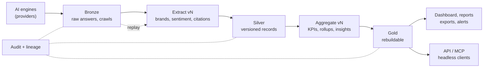

# Tenets

These tenets are the bar every design, pull request and roadmap item in this repository is measured against.

This project measures how AI engines answer, mention and cite brands, and turns those answers into KPIs, benchmarks
and content actions. It is a sample today and is designed so it could become a managed service tomorrow.

Adapted from the tenets of [sample-voice-of-customer-datalake](https://github.com/aws-samples/sample-voice-of-customer-datalake/blob/main/TENETS.md).

## How to use these tenets

- **They are ranked.** When two tenets conflict, the higher one wins.
- **They are ours unless we know better ones.** To change a tenet, open a pull request that edits this file and
  explains why. Tenets are never changed as a side effect of another change.
- **They decide arguments.** If a tenet can't settle a real design disagreement, rewrite it until it can.
- **Every pull request names the tenets it touches** (see [Pull request checklist](#pull-request-checklist)).
- **They are checked, not just read.** See [How the tenets are enforced](#how-the-tenets-are-enforced).

---

## Product tenets (ranked)

### 1. Data first. The answers are the product.

What each AI engine answered, which brands it named and which sources it cited, for which keyword, persona, market
and time, is the core of the tool and the reason it exists. KPIs, reports, insights, content and the MCP server all
read from it. If a feature puts the integrity, lineage or completeness of that record at risk, we drop the feature.
We don't weaken the data.

### 2. One measurement, defined once.

A figure means the same thing on every page, report, export, alert and MCP answer. Every KPI has one definition
([docs/kpi-definitions.md](docs/kpi-definitions.md)), one implementation (`lambda/shared/kpi_engine.py`) and one
display definition (`web/src/constants/kpiDefinitions.ts`), and the three change together. A view never computes its
own version of a KPI the engine already provides. Every figure says what it was computed over: the scope, the
period, the engines and the number of answers behind it, and whether it was cut short.

### 3. Rules compute, AI explains.

Numbers, rankings, gaps and insights come from code with named thresholds, so the same data always gives the same
result. A model writes prose from those computed facts only: a written insight or recommendation that cites a number
or an insight not in its evidence is dropped (`lambda/report-insights/`). Brand extraction and sentiment are model
calls by design; their output is stored with the answer it came from, so it can be checked against the answer.
Everything except model-backed features keeps working when Bedrock is unavailable: stored answers, KPIs, reports and
exports do not wait for a model.

### 4. Headless by design. The rules live in the server, not the screen.

Every capability is available through the API, and through MCP where it is safe to expose, without the dashboard.
The dashboard is one client among many (coding assistants, agents, CLIs, other tools). Permissions, spend limits,
confirmations and audit are enforced server-side, so a headless client can never do something the UI would refuse.

### 5. Every engine, one contract.

We track as many AI engines and search APIs as customers use. Adding a provider means adding its client and its
configuration behind the provider contract (`lambda/search/`), not changing the workflow, the tables or the KPIs. A
provider that fails, throttles or times out costs its own answers only, never the run.

### 6. Build it as if it is already a service.

Even as a sample, we design for a managed service: least privilege, infrastructure as code, serverless pay-per-use,
encryption by default, and cost visibility per workload. The data outlives any single deployment or stack.

### 7. Fully serverless. Cost-optimised by default, performance by choice.

The platform runs fully serverless and, by default, with **no fixed monthly cost** beyond what the data itself needs:
no WAF, no SnapStart, no provisioned concurrency or capacity, no NAT gateway, no always-on database, cache or
container. As a GitHub sample, we would rather wait a couple of seconds more than pay to hide a slow path: we make the
Lambda faster (smaller imports, right-sized memory, fewer round trips) before we reach for a paid feature.

Performance or protection features that carry a fixed cost are **opt-in**, behind a flag a deployment chooses.
Architecturally we build for the service either way (tenet 6); only the bill is opt-in. Lambda **reserved**
concurrency is free (it only caps a function's share of the account) and is allowed by default.

---

## Data lake tenets (non-negotiable)

These put Tenet 1 into practice. For these, the default answer to "can we make an exception?" is **no**.

### D1. Immutable and append-only.

Nothing is overwritten. Every run adds new answers; it never replaces an earlier run's. Corrections, re-extractions
and manual edits create a new version and keep the previous one. The history of a keyword's answers is part of the
record: trends exist only because old answers are kept.

### D2. Three tiers, each with a contract.

| Tier | Holds | Contract |
| --- | --- | --- |
| **Bronze** (raw) | Every provider answer exactly as returned (`raw-responses` bucket), every crawled page and screenshot, with the run, keyword, persona, market, provider, model and time | Write-once. Never edited after the fact. Keyed so a later run never overwrites an earlier one. |
| **Silver** (conformed) | The structured records derived from Bronze: the answer row and its extracted brands, sentiment and ranks (`SearchResults`), deduplicated citations (`Citations`), crawl summaries and SEO data (`CrawledContent`) | Versioned. Every record names the Bronze item it came from and the pipeline, model and prompt version that produced it. |
| **Gold** (curated) | KPIs, citation rollups, KPI snapshots, run summaries, report insights, recommendations and ranking analyses | Always derived. Can be thrown away and rebuilt from Silver at any time. |

Data that is not derived from answers is not Gold: keywords and groups, markets, brand tracking, personas, provider
settings, alert thresholds, saved reports, Action Center statuses, generated content and the audit trail are primary
data. They are kept, not expired, and protected like Silver.

### D3. Replay Raw → Gold at any time.

Extraction and aggregation are versioned code. Any slice (a keyword, a provider, a market, a date range, or
everything) can be reprocessed from Bronze to Gold with a new pipeline, prompt or model version, without losing
anything. Reprocessing is a first-class feature, not a repair script, and old and new outputs can be compared side by
side.

### D4. Full audit and lineage.

Every write records who or what made it (user, MCP client, workflow step), when, why, and with which version. Any
KPI, insight or content sentence can be traced back to the answers and citations behind it, and any raw answer can be
traced forward to everything derived from it.

### D5. Answers are never removed. A legal obligation is the only exception.

The store of answers, citations and crawls is the single source of truth, so it is not deleted: removing a keyword,
a persona, a market or a provider stops future runs and leaves the history in place. The only exception is a legal
obligation (an erasure request, a takedown, a retention limit the deployment is bound to). It states its legal basis,
is approved and logged, leaves a tombstone, and reaches every derived copy, because lineage tells us where those
copies are.

The artifacts people create (keyword groups, personas, saved reports, generated content, research jobs) belong to
them: deleting one really deletes it, and the deletion is recorded (D4).

### D6. Flexible pipelines, fixed contracts.

Anyone can add, change and chain providers, extractors, rules and models. The tier contracts (schema, versioning,
lineage, audit) stay fixed. Flexibility never gets past the contract.

### D7. Discoverable and understood.

Data that nobody can find or understand is worthless. Every table, bucket and field is described, and the KPIs are
defined in one place (tenet 2). Users and agents can explore and search the answers, citations and crawls, with or
without AI.



---

## Where the platform stands today

The tenets are the bar, and the code does not meet all of them yet. A change must not move further away from a
tenet; closing a gap is a change of its own. Known gaps (2026-11):

| Tenet | Today | Gap |
| --- | --- | --- |
| 2 | One KPI engine (`lambda/shared/kpi_engine.py`) serves Visibility, the per-group report, Executive Summary, Brand Visibility, Competitor Benchmark, AI Engines, Sources, Sentiment and Keyword Deep Dive, their exports and the KPI alerts; `lambda/shared/test_kpi_contract.py` keeps the definitions document, the engine and the dashboard definitions in step. Capped reads return a truncation flag. | The Dashboard, Brand Mentions, Personas, Prompt Insights, Citation Gaps, Action Center and the Competitor Gap and Content Action Plan reports still compute their own figures (README, "KPIs"). |
| 3 | Insights are rule-based with named thresholds (`insights_engine.py`, `insights_citations.py`); the GenerateInsights validator drops written items that cite unknown insights or numbers. | Brand extraction runs once, in the search step (`lambda/search/handler.py`), and is never re-run on a stored answer (D3). |
| 4 | Every dashboard capability has a REST route; the MCP server replays tool calls against the API handlers as the signed-in user, with spend confirmations and per-caller limits. | User management, provider keys, brand-configuration and schedule writes and deletes are not exposed through MCP (by decision, README "MCP server"). |
| 5 | Ten providers behind one search contract, each with its own Lambda and concurrency cap; a failed provider does not fail the run. | Not measured here: how much provider-specific code lives outside `lambda/search/`. |
| 6 | Everything in CDK; tables and data buckets are `RETAIN` with point-in-time recovery; buckets block public access and require TLS. | Encryption uses AWS-managed keys, not a key the deployment controls; several roles get table-wide `grantReadWriteData` / `grantWriteData` (which include deletes) rather than per-action grants; cost is visible per stack only. |
| 7 | No WAF by default (SECURITY.md explains how to add one); on-demand DynamoDB; no NAT gateway or always-on compute. | Secrets Manager holds one secret per provider key ($0.40 each per month). No test fails the synth on a new fixed-cost resource. |
| D1 | Each run writes new `SearchResults` rows (keyword / timestamp_provider) and new raw-response objects; crawls are keyed by URL and crawl time. | Data buckets are unversioned and raw objects are not write-once; `Citations` rows are updated in place by deduplication. |
| D2 | Bronze ≈ the `raw-responses` bucket and screenshots; Silver ≈ `SearchResults`, `Citations`, `CrawledContent`; Gold ≈ rollups, snapshots, summaries, insights. | The raw object also stores the extracted brands beside the raw answer; the raw-response write is best-effort (a failure is logged and the row is stored without it); rows carry no pipeline or prompt version. |
| D3 | Citation rollups are rebuilt after every run. | No replay of extraction or aggregation from Bronze; no side-by-side comparison of versions. |
| D4 | MCP writes and spend calls leave an audit record (365 days) in `CitationAnalysis-McpState`. | REST writes carry no uniform actor / reason / version record; no lineage from a KPI or insight back to the answers behind it beyond the scope it was computed for. |
| D5 | Deleting a keyword deletes the keyword row only; its answers and citations stay. | Several tables expire rows by TTL (KeywordResearch, SelfReflection, RecommendationStatus, KpiSnapshots, ReportInsights, KpiAlerts, ContentChanges), some of them primary data (Action Center statuses); there is no erasure process with a legal basis and tombstone. |
| D6 | Providers, markets, personas, brand tracking and alert thresholds are configurable without code changes. | The contracts that flexibility must respect are incomplete (D2 versions, D4 audit). |
| D7 | Tables, buckets and KPIs are documented (README "Data", docs/kpi-definitions.md); Raw Responses and Recent Searches browse Bronze and Silver. | No data catalogue. |

---

## How the tenets are enforced

The same checks run locally and on GitHub (`scripts/validate.sh`, the `quality gates` workflow), so a green local run
means a green pipeline.

- **KPI contract** (tenet 2, `lambda/shared/test_kpi_contract.py`, part of pytest): the definitions document, the
  engine and the dashboard definitions agree.
- **Cross-boundary contracts** (tenets 2 and 4, `scripts/check-contracts.py`): every env var CDK sets is read by a
  Lambda and the reverse; every member of `web/src/types` is read by dashboard code.
- **Admin routes** (tenet 4, `lambda/api/test_admin_route_authorization.py`): admin-only routes refuse other users on
  the server, whatever the client.
- **Pull request description**: every PR has a `## Tenets` section naming the tenets it touches (`1`–`7`, `D1`–`D7`)
  or `none` (`.github/PULL_REQUEST_TEMPLATE.md`). Reviewed by people; not checked by CI yet.

---

## Pull request checklist

Copy into the pull request description and answer every line that applies.

```markdown
## Tenets

Tenets touched: <!-- e.g. 2, D1, D4 — or "none" -->

- [ ] Data: no stored answer, crawl or raw object is changed or deleted; corrections create new versions (D1, D2)
- [ ] Replay: the change can be reprocessed from Bronze and records its pipeline/prompt/model version (D3)
- [ ] Audit: new writes record actor, time, reason and version (D4)
- [ ] No new delete path for answers outside a legal obligation; artifact deletes are recorded (D5)
- [ ] Measurement: KPIs come from the KPI engine, and docs, engine and dashboard definitions change together (2)
- [ ] AI: numbers come from rules; model output cites only computed evidence; non-AI features work without Bedrock (3)
- [ ] Headless: available and enforced via the API/MCP, not only the UI (4)
- [ ] Providers: a new engine fits the provider contract; its failure costs only its own answers (5)
- [ ] Cost: no new fixed monthly cost by default; a paid feature is opt-in behind a flag (7)
- [ ] Trade-off: if this weakens a lower tenet to serve a higher one, explain it here
```
