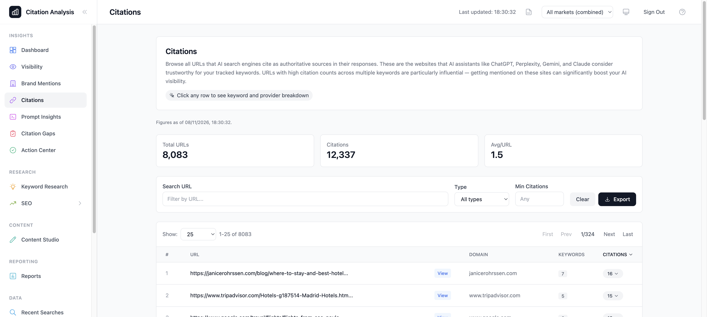

# Why AI citation numbers changed in 2.43 (GEO KPI corrections)

Version 2.43 changes four things in how AI search visibility (GEO) figures are measured: which sources count as citations, how empty replies count, how branded queries are flagged, and what KPI alerts compare.

The definitions are in [KPI definitions](kpi-definitions.md#conventions); this note says what moves and in which direction.

## What changed

1. **Only cited sources count.** OpenAI, Perplexity and Claude report two kinds of links: the sources the answer cites, and the pages the engine only read while searching. Until 2.43 both counted as citations. Now only the cited ones do. The pages it only read are still stored on each result (`retrieved_urls`) but never count. Gemini and Google AI Overviews were already reported as cited sources and are unchanged. A URL written in the answer text still counts as cited. Each engine says what it cites in its own way:
   - **OpenAI**: the `url_citation` annotations of the answer. The other `web_search_call` sources were only read.
   - **Perplexity**: numbered markers in the answer (`[1]`, `[web:2]`, `[1, 3]`), each naming one of the search results, plus any message annotations. An answer marked `[1][3]` with five search results cites two and only read three. Every request asks Perplexity to cite inline with one source per bracket (`[1][2]`), so answers now usually carry markers. An answer that still has no marker and no annotation cites all its search results, because Perplexity reports them as the sources of that answer; such answers count exactly as before 2.43.
   - **Claude**: the citations attached to its text (`web_search_result_location`). The search results it does not cite were only read. Claude's web search runs in direct mode (`allowed_callers: ["direct"]`): Claude reads the search results itself and cites them on the text they back. In the tool's default dynamic filtering mode, where code filters the results first, answers carry almost no text citations, so 2.43 does not use it.
2. **Empty replies are no answers.** An engine call that returned no answer text used to count as an answer that did not mention you. It now counts as *no answer*, like a Google results page without an AI Overview, and is left out of every KPI.
3. **Branded queries are flagged.** A query that names your brand or one of your domains ("is Hotel Example good?") gets answers that mention you almost by construction. Each answer now records whether its query was branded. The Visibility page has a **Queries** filter (all / without your brand / naming your brand), which defaults to all queries, so your existing views keep their numbers.
4. **Alerts compare like for like.** KPI alerts now compare only the answers that are present in both runs for the same keyword, persona, AI engine and market, and only answers to queries that do not name your brand. A run where fewer than 90 % of the queries were answered raises no alerts. Each snapshot records why it was or was not compared (`comparable`, `scope_changed`, `incomplete` or `no_previous`).

## Which numbers move

| Figure | Direction | Why |
|---|---|---|
| Citations, citation rate: OpenAI | usually down | the sources it searched and did not cite no longer count |
| Citations, citation rate: Perplexity | usually down | answers are asked for inline markers and now usually carry them; a marked or annotated answer counts only the results it names, an answer without markers still counts all its results |
| Citations, citation rate: Claude | down | only the citations on its text count; the pages it only read no longer do |
| Citations, citation rate: Gemini, Google AI Overviews | unchanged | they only ever reported cited sources |
| Citation share | up or down | both your cited domains and all cited domains shrink; the share moves with whichever shrinks more. |
| Citations page, crawled pages, cited-domain tables | fewer rows | only cited URLs are stored, deduplicated and crawled |
| Answers | slightly down | empty replies are no longer answers |
| Mention rate, top-1/top-3 share, visibility score | slightly up | the empty replies they used to count as "not mentioned" are gone |
| KPI alerts | fewer | changes caused by a new engine, persona or market, by failed calls, or by branded queries no longer raise alerts |

Mentions, share of voice, average position and sentiment are measured as before.

## History

Results stored before 2.43 keep the citations they were stored with; the change applies to runs from 2.43 on. Because the definitions changed, the KPI definition version moved to 4: the first run after the upgrade sets a new alert baseline and raises no alert. Expect a step in citation trends at the upgrade date; compare runs from before and after it with care.
