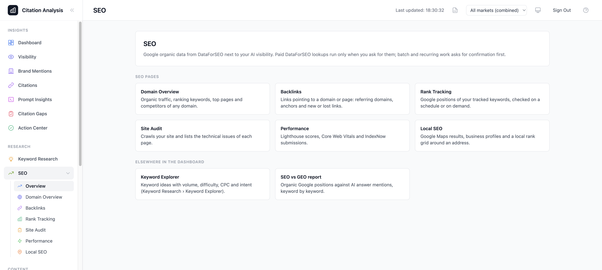

# SEO features: Google organic data next to AI search visibility

The SEO features put Google organic data next to the AI-visibility (GEO) numbers: where you rank, what a domain ranks
for, who links to it, how a business shows on Google Maps, and whether your site is technically fit for search
engines and answer engines. Search data comes from [DataForSEO](https://dataforseo.com/), a pay-per-use API.

Everything lives in its own stack, `CitationAnalysisSeoStack` (`lib/seo-stack.ts`), with its own API
(`CitationAnalysis-SeoApi`, Cognito-protected, routes under `/api/seo/`), because the main stack is at
CloudFormation's 500-resource limit.

## Where to find it

**SEO** sits in the sidebar's **Research** group, after Keyword Research. It expands to its pages: Overview
(`/seo`), Domain Overview, Backlinks, Rank Tracking, Site Audit, Performance and Local SEO. The overview has one card
per page, links to the Keyword Explorer and the SEO vs GEO report and, when something is missing, the setup step to
do next. Each page has its own URL (`/seo/<page>`), so it can be bookmarked and the browser's back button works; an
unknown `/seo/...` path opens the overview.

| Page | Path | What it does | Details |
|---|---|---|---|
| Domain Overview | `/seo/domain` | Organic traffic estimate, ranking keywords, top pages and Google competitors of any domain; traffic snapshots of your and your competitors' domains, run by a schedule on Operations › Schedule. | [seo-domain.md](seo-domain.md) |
| Backlinks | `/seo/backlinks` | Links pointing to a domain, subdomain, subfolder or page: referring domains, anchors, new and lost links, authority over time. | [seo-backlinks.md](seo-backlinks.md) |
| Rank Tracking | `/seo/rank-tracking` | Google positions of a domain (from Settings › Brand tracking) for the Settings keywords of the header market or of one keyword group, desktop and/or mobile, checked on a schedule or on demand, with history and the position distribution per check. Admins create trackers, add and remove keywords and start checks. | [seo-rank-tracking.md](seo-rank-tracking.md) |
| Site Audit | `/seo/site-audit` | Crawls your own site and lists technical SEO issues and AI-readiness checks per page. | [seo-site-audit.md](seo-site-audit.md) |
| Performance | `/seo/performance` | Lighthouse scores and Core Web Vitals of your pages, and IndexNow submissions of changed URLs. | [seo-performance.md](seo-performance.md) |
| Local SEO | `/seo/local` | Google Maps and Local Finder results, Google Business Profiles (reviews, questions, posts) and a local rank grid around a point. | [seo-local.md](seo-local.md) |

Elsewhere in the dashboard:

- **Keyword Explorer** (Keyword Research › Keyword Explorer): keyword ideas for a seed in the header market with
  search volume, 12-month trend, keyword difficulty, CPC, competition and intent; filters, Excel export, the Google
  results page of a keyword (top 20, or 50 on request) and "Track keywords" into a keyword group. Every national
  research stores its rows' metrics in `CitationAnalysis-SeoKeywordMetrics`, so tracking adds no cost. "Use a tracked
  keyword" fills the seed with one of the header market's Settings keywords (no lookup until Search).
- **Google AI Overviews** as an answer engine in every analysis run: the AI Overview of the Google results page for
  the plain keyword (one search per keyword per run, whatever the personas). A page without an overview is *no
  answer* and counts in no KPI; the same call records the organic top 10.
- **SEO vs GEO report** (`/reports/seo-geo`) and the custom report blocks *SEO vs GEO quadrants* and *SEO vs GEO
  table*: organic position against AI mention rate per keyword. Definitions: [seo-metrics.md](seo-metrics.md).
- **Action Center**: the SEO recommendations (for example "ranks on Google but AI answers rarely name you") are
  listed with the answer-based ones, marked **SEO**, and their status is tracked the same way. If the SEO API cannot
  be reached, the answer-based recommendations still show.
- **Dashboard**: two cards, *SEO vs GEO* (keywords per quadrant) and *Rankings* (tracked keywords in Google's top 3
  and top 10 at each tracker's newest check). Both are free reads of stored data; the dashboard never starts a paid
  call.
- **MCP tools**: free reads (`get_keyword_metrics`, `get_seo_geo_comparison`, `get_seo_recommendations`,
  `get_rank_tracking`, `get_domain_snapshots`, `get_backlink_snapshots`, `get_site_audits`, `get_local_job`) and
  paid DataForSEO lookups split into an estimate and a run (`estimate_seo_*` / `run_seo_*`; the jobs
  `estimate_seo_job` / `start_seo_job` are for Admins). Details: [mcp.md](mcp.md).

The header market selector applies to every SEO page: lookups run in the selected market (the global market when
every market is combined).

## Setup

1. Create a DataForSEO account and open **API Access** in its dashboard (https://app.dataforseo.com/api-access) for
   the API login and password. New accounts get $1 of free credit.
2. Deploy: `npm run deploy` deploys every stack. To add the AI Overviews engine to the analysis workflow, deploy the
   SEO stack first, then the main stack with `-c seoEngine=true` (the workflow calls the engine's Lambda,
   `CitationAnalysis-Search-google_ai_overview`, by name).
3. Rebuild the dashboard (`./scripts/build-web.sh` reads `SeoApiUrl` into `VITE_SEO_API_URL`). Without the SEO stack
   the SEO pages say "SEO data is not set up" and the SEO overview says the stack is not deployed.
4. As an Admin, open **Settings › AI providers › SEO data › DataForSEO**, enter the login and password and save. The
   login is checked with DataForSEO's free account endpoint, which also shows the balance on the card. The secret is
   stored as `citation-analysis/dataforseo-key`. Until then the SEO overview shows a "Set up SEO data" panel.
5. Enable **Google AI Overviews** in Settings › AI providers (it uses the DataForSEO login; it has no key of its own).

## Who can do what

Every signed-in user can read every SEO page and run one-off lookups (a domain overview, a backlinks table, a
results page, a business profile). Anything that creates, changes, deletes or schedules recurring paid work (rank
trackers and their keywords, snapshot schedules, site audits, batches) is for Admins.

Each user may make at most 100 paid one-off lookups per UTC day through the API (`SEO_PAID_REQUESTS_PER_DAY` on
`CitationAnalysis-SeoRouter`); past it the API answers 429 `DAILY_LIMIT` and makes no DataForSEO call. A lookup
answered from the cache still counts. MCP callers also have the MCP server's own `seoCallsPerDay` limit. A paid
snapshot schedule can only be saved enabled, or run now, with `confirm_paid: true` (the dashboard sends it after
its confirmation).

## Prices

DataForSEO bills per call; your account is billed directly. The figures below are list prices the code estimates
with, read from DataForSEO's per-account price table (`GET /v3/appendix/user_data`) in September 2026
(`lambda/shared/dataforseo_pricing.py`, `lambda/shared/local_seo_pricing.py`); check DataForSEO's own pricing for
current values. Each page's document has its full table.

| Area | Typical cost |
|---|---|
| Keyword research, Labs countries (auto mode: two calls of half the result limit each) | $0.012 + $0.00012 per row per call; ×2 with clickstream data |
| Keyword research, Google-Ads-only countries | $0.09 per call |
| Keyword metrics (up to 700 keywords per call) | $0.012 + $0.00012 per keyword (Labs) or $0.09 (Google Ads) |
| Google results page (SERP panel) | $0.002 for the first 10 results + $0.0015 per further 10; ×5 for search operators |
| Google AI Overviews (per keyword per run) | $0.004 ($0.002 when no overview loads) |
| Rank Tracking, per keyword and device | $0.002 live (manual), $0.0006 queued (scheduled), + per extra page of results |
| Domain Overview | about $0.03 per analysis; $0.144 per traffic snapshot |
| Backlinks | about $0.06 per domain overview; about $0.03 per 100-row table page |
| Local SEO | $0.002 per Maps results page; $0.0054 per business profile; $0.0012 per rank-grid point |
| Site Audit | free (no DataForSEO call) |
| Performance | see [seo-performance.md](seo-performance.md) |
| Account balance, SEO vs GEO, recommendations, stored results | free |

How spending is kept in check (there are no spend caps):

- Paid lookups run only when you press the button; opening a page, switching tabs or focusing a field costs nothing.
- Batch and recurring work (rank checks and schedules, snapshots, audits, the rank grid, Lighthouse batches) asks
  for confirmation first, naming the paid calls it starts when the count is known.
- Prices are shown before money is spent where the dashboard can work them out: the Keyword Explorer shows the
  ceiling of one search under the Search button ("up to $0.05 per search", from `Seo/seoPrices.ts`, which mirrors
  `lambda/shared/dataforseo_pricing.py`), the Backlinks **Snapshot now** confirmation shows the price the API
  estimates (`estimated_run_cost_usd`), and the paid **Export to Excel** of the Domain Overview and Backlinks tables
  shows the price ceiling and request count before Download (exporting the rows on screen is free). Other SEO screens
  show call counts, not prices. The figures in these docs are for reference; the DataForSEO card in Settings › AI
  providers shows the account balance.
- Answers are cached (keyword research 24 h, a seed with no ideas 1 h, results pages and domain lookups 12 h,
  backlinks 6 h), so a repeat is free until the entry expires; an empty answer never replaces cached data.
- DataForSEO bills a call when it is made, so a billed call that timed out or failed is never re-sent automatically,
  and every call is cut off before the API's 29-second limit.
- Scheduled work uses DataForSEO's queued mode, which costs less than live calls.

The SEO API's stage throttle (20 requests a second) is the only rate limit.

## Markets

A market's country maps to DataForSEO's location code and its language to a language DataForSEO serves for that
country (`lambda/shared/dataforseo_locations.py`); the global market asks the United States in English. Keyword
difficulty and intent are not available in the 49 countries DataForSEO serves only through Google Ads data. A market
DataForSEO does not serve answers `UNSUPPORTED_MARKET` before any paid call.

## See also

- [seo-metrics.md](seo-metrics.md): definitions of the SEO vs GEO metrics and quadrants.
- [geo-corrections.md](geo-corrections.md): why some AI-visibility figures changed when cited sources, empty
  replies and branded queries started being treated differently.

## Data

The SEO stack's tables (keys, contents, which items expire) and the `seo` bucket's key layout are listed in the
README, [Data](../README.md#data).
